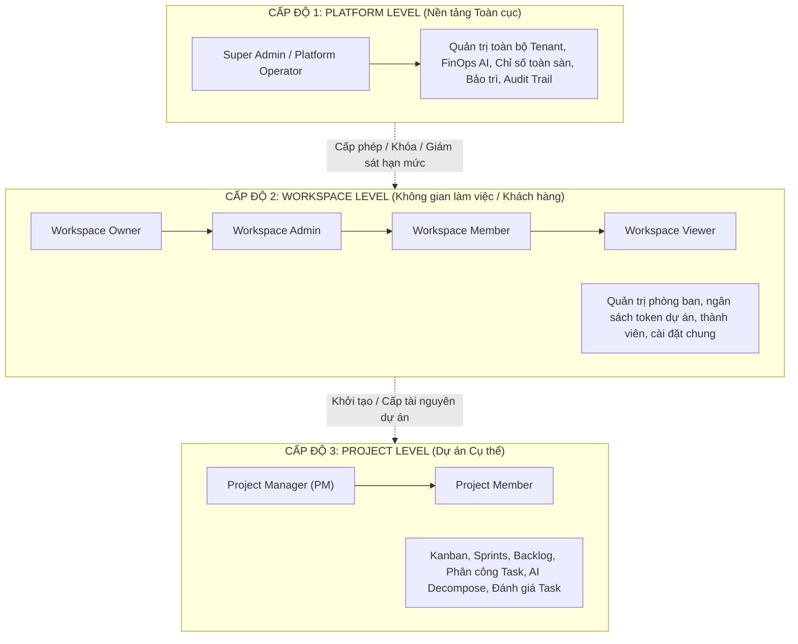

# Phân hệ Quản trị Nền tảng (Platform Administration / Super Admin)
**Tài liệu Đặc tả Nghiệp vụ (Business Analysis - BA) & Ma trận Phân quyền SmartTask**
*Phiên bản: 1.0 — Ngày chốt: 19/09/2026 — Trạng thái: Sẵn sàng kiểm thử & hiện thực*

---

## 1. Tổng quan Nghiệp vụ & Kiến trúc Phân tầng (3-Level Multi-Tenancy)

SmartTask được thiết kế theo mô hình **B2B Multi-tenant SaaS**. Để đảm bảo tính toàn vẹn dữ liệu, kiểm soát rủi ro, tối ưu chi phí hạ tầng (đặc biệt là token AI) và vận hành hệ thống ở quy mô lớn, hệ sinh thái phân quyền được chuẩn hóa thành **3 cấp độ độc lập nhưng có mối liên kết phân cấp**:



---

## 2. Ma trận Phân quyền 3 Cấp độ (3-Level RBAC & Boundary Matrix)

Hệ thống tuân thủ nguyên tắc **Zero Trust** giữa các Tenant (Workspaces). Quyền ở cấp trên **không tự động biến thành quyền nội bộ** của cấp dưới nếu không được gán rõ ràng (ví dụ: Super Admin không tự ý sửa Task nội bộ của khách hàng nếu không kích hoạt chế độ kiểm toán khẩn cấp Support Impersonation có ghi log).

### 2.1 Bảng Ma trận Quyền Hạn Chi Tiết

| Phân nhóm chức năng | Hành vi / Quyền hạn cụ thể | Platform Level (Super Admin) | Workspace Owner | Workspace Admin | Workspace Member | Workspace Viewer | Project PM | Project Member |
| :--- | :--- | :---: | :---: | :---: | :---: | :---: | :---: | :---: |
| **Platform Telemetry** | Xem Health, DAU/MAU, Uptime, Database Pool toàn sàn | **Toàn quyền (CRUD)** | ❌ Chặn (403) | ❌ Chặn (403) | ❌ Chặn (403) | ❌ Chặn (403) | ❌ Chặn (403) | ❌ Chặn (403) |
| | Xem báo cáo tài chính SaaS (MRR, Churn, ARR) | **Toàn quyền** | ❌ | ❌ | ❌ | ❌ | ❌ | ❌ |
| **Workspace Governance** | Cấp phép Workspace mới, cấu hình Tier (Free/Team/Enterprise) | **Toàn quyền** | ❌ | ❌ | ❌ | ❌ | ❌ | ❌ |
| | Đình chỉ (Suspend) / Mở khóa Workspace vi phạm | **Toàn quyền** | ❌ | ❌ | ❌ | ❌ | ❌ | ❌ |
| | Thay đổi Quota Workspace (User seat, Storage, AI Token) | **Toàn quyền** | ❌ | ❌ | ❌ | ❌ | ❌ | ❌ |
| | Chuyển quyền sở hữu Workspace (Transfer Ownership) | Can thiệp hỗ trợ | **Toàn quyền** | ❌ | ❌ | ❌ | ❌ | ❌ |
| | Quản lý thành viên Workspace (Mời, Đổi vai trò, Kick) | Audit log | **Toàn quyền** | **Toàn quyền** | ❌ | ❌ | ❌ | ❌ |
| | Cài đặt nội bộ Workspace (Giờ làm, Ngưỡng tải, Kỹ năng) | Audit log | **Toàn quyền** | **Toàn quyền** | Chỉ đọc (GET) | Chỉ đọc (GET) | ❌ | ❌ |
| **User Risk & Security** | Khóa tài khoản toàn nền tảng (Global User Ban) | **Toàn quyền** | ❌ | ❌ | ❌ | ❌ | ❌ | ❌ |
| | Thu hồi toàn bộ Refresh Token & Force Logout khẩn cấp | **Toàn quyền** | Chỉ thành viên WS | Chỉ thành viên WS | Chỉ bản thân | Chỉ bản thân | ❌ | Chỉ bản thân |
| | Xem lược sử đăng nhập nghi vấn (Brute-force, Lạ IP) | **Toàn quyền** | ❌ | ❌ | ❌ | ❌ | ❌ | ❌ |
| **FinOps AI Toàn Sàn** | Quản trị Danh mục AI Model toàn cầu (Global Catalog) | **Toàn quyền** | ❌ | ❌ | ❌ | ❌ | ❌ | ❌ |
| | Thiết lập Trần Ngân sách AI toàn sàn & Cơ chế Fallback | **Toàn quyền** | ❌ | ❌ | ❌ | ❌ | ❌ | ❌ |
| | Thiết lập Hạn mức Token hàng ngày cho từng User | Can thiệp sàn | **Toàn quyền** | **Toàn quyền** | ❌ | ❌ | ❌ | ❌ |
| | Xem Sổ cái Token & Chi phí VND/USD theo Workspace | Toàn sàn | Nội bộ WS | Nội bộ WS | Chỉ của mình | ❌ | Chỉ của mình | Chỉ của mình |
| **Vận hành & Bảo trì** | Kích hoạt Chế độ Bảo trì Hệ thống (Maintenance Mode) | **Toàn quyền** | ❌ Chặn (503) | ❌ Chặn (503) | ❌ Chặn (503) | ❌ Chặn (503) | ❌ Chặn (503) | ❌ Chặn (503) |
| | Tra cứu Nhật ký Kiểm toán Bất biến (System Audit Trail) | **Toàn sàn** | Chỉ log WS | Chỉ log WS | ❌ | ❌ | Chỉ log Dự án | ❌ |
| **Dự án & Tác vụ** | Tạo / Xóa Dự án trong Workspace | ❌ (Trừ test) | **Toàn quyền** | **Toàn quyền** | ❌ | ❌ | ❌ | ❌ |
| | Quản trị Sprint (Start, Close, Đổi cột WIP Limit) | ❌ | ❌ | ❌ | ❌ | ❌ | **Toàn quyền** | Chỉ xem/kéo |
| | Tạo Task, Kéo thả Kanban, Nhập tiến độ | ❌ | ❌ (Trừ khi join) | ❌ (Trừ khi join) | ❌ (Trừ khi join) | ❌ | **Toàn quyền** | **Toàn quyền** |

---

## 3. Đặc tả Chi tiết User Stories & Tiêu chí Chấp nhận (Acceptance Criteria)

### US-ADM-01: Giám sát Chỉ số Sức khỏe & Kinh doanh Nền tảng (Platform Observability & Executive Dashboard)

- **Mô tả:** Là một **Platform Super Admin**, tôi muốn theo dõi bảng đồng hồ realtime về các chỉ số vận hành kỹ thuật (APM, Socket connections, Database pool, Worker queue) và chỉ số kinh doanh SaaS (DAU/MAU, Số lượng Workspace hoạt động/bị đình chỉ, Doanh thu ước tính, Tỷ lệ đốt token AI), để kịp thời phát hiện sự cố nghẽn cổ chai và nắm bắt tình hình tăng trưởng.

#### Tiêu chí Chấp nhận (Acceptance Criteria - Gherkin):

```gherkin
Feature: Giám sát chỉ số nền tảng (US-ADM-01)

  Scenario: Super Admin truy cập Dashboard Tổng quan thành công
    Given Tôi đã đăng nhập với tài khoản có quyền "isPlatformAdmin = true"
    When Tôi truy cập URL "/admin/dashboard" hoặc gọi "GET /api/v1/admin/overview"
    Then Hệ thống trả về mã HTTP 200 kèm payload JSON gồm:
      | Trường dữ liệu       | Ý nghĩa                                         |
      | systemHealth.status  | "HEALTHY" / "DEGRADED" / "DOWN"                 |
      | systemHealth.uptime  | Thời gian chạy liên tục (giây)                 |
      | dbPool.active        | Số kết nối PostgreSQL đang phục vụ              |
      | sockets.connected    | Số lượng WebSocket clients đang kết nối realtime|
      | tenants.total        | Tổng số Workspace trên toàn hệ thống            |
      | tenants.active       | Số Workspace đang hoạt động                     |
      | tenants.suspended    | Số Workspace đang bị khóa                       |
      | users.total          | Tổng số người dùng đăng ký                      |
      | users.dau            | Số người dùng tích cực trong 24 giờ qua         |
      | aiUsage.todayTokens  | Tổng token tiêu thụ toàn sàn hôm nay            |
      | aiUsage.todayCostUsd | Tổng chi phí AI toàn sàn hôm nay (USD)          |

  Scenario: Người dùng không có quyền Super Admin cố tình truy cập Dashboard
    Given Tôi đăng nhập với tư cách "Workspace Owner" hoặc "Regular User"
    When Tôi gửi yêu cầu "GET /api/v1/admin/overview"
    Then Hệ thống từ chối với mã lỗi HTTP 403 Forbidden
    And Body trả về cấu trúc chuẩn: {"code": "PLATFORM_ADMIN_REQUIRED", "message": "Bạn không có quyền quản trị nền tảng"}

  Scenario: Cảnh báo bất thường (Anomaly Spike Alert)
    Given Hệ thống ghi nhận tỷ lệ lỗi HTTP 5xx vượt quá 5% trong vòng 5 phút
    When Super Admin đang mở màn hình Dashboard
    Then Widget "System Health" đổi sang màu Đỏ nhấp nháy (Status: "DEGRADED")
    And Hiển thị danh sách Top 3 endpoint có độ trễ cao nhất (P99 > 800ms)
```

---

### US-ADM-02: Quản trị Danh sách Workspace / Khách hàng (Tenant Lifecycle Management)

- **Mô tả:** Là một **Platform Super Admin**, tôi muốn quản lý vòng đời của các Workspace (Cấp phép mới, Thay đổi gói dịch vụ Free/Team/Enterprise, Đình chỉ khi vi phạm/nợ cước, Khôi phục, hoặc Đưa vào diện chờ xóa sau 30 ngày), để bảo vệ hạ tầng và thực thi chính sách thương mại.

#### Tiêu chí Chấp nhận (Acceptance Criteria - Gherkin):

```gherkin
Feature: Quản trị danh sách Workspace (US-ADM-02)

  Scenario: Super Admin đình chỉ (Suspend) một Workspace vi phạm
    Given Workspace "Acme Corp" (ID: ws-123) đang ở trạng thái "ACTIVE"
    And Có 15 thành viên đang đăng nhập và mở kết nối WebSocket
    When Super Admin gọi "POST /api/v1/admin/workspaces/ws-123/suspend" kèm lý do "Vi phạm bản quyền dữ liệu"
    Then Database cập nhật "workspaces.status = 'SUSPENDED'", "suspended_at = NOW()"
    And Hệ thống phát sự kiện realtime "workspace:suspended" đến toàn bộ Socket thuộc room "workspace:ws-123"
    And Kết nối Socket của tất cả thành viên thuộc "ws-123" lập tức bị ngắt với mã đóng 4403
    And Hệ thống ghi 01 bản ghi vào "platform_audit_logs" với action "WORKSPACE_SUSPEND"

  Scenario: Thành viên cố gắng thao tác trong Workspace đã bị đình chỉ
    Given Workspace "Acme Corp" đã bị "SUSPENDED"
    When Thành viên gọi bất kỳ API nào như "GET /api/v1/workspaces/ws-123/projects" hoặc "POST /api/v1/projects/pj-1/tasks"
    Then API trả về HTTP 403 Forbidden
    And Mã lỗi trả về là: {"code": "WORKSPACE_SUSPENDED", "message": "Không gian làm việc đã bị đình chỉ hoạt động bởi Quản trị viên"}
    And Giao diện Frontend hiển thị màn hình khóa Banner cảnh báo liên hệ Quản trị viên nền tảng

  Scenario: Nâng cấp gói dịch vụ (Tier Upgrade) từ FREE lên ENTERPRISE
    Given Workspace "Beta Tech" đang ở gói "FREE" (Giới hạn 5 seats, 1GB storage, 500k token/tháng)
    When Super Admin gọi "PATCH /api/v1/admin/workspaces/ws-456/tier" với body:
      """json
      {
        "tier": "ENTERPRISE",
        "maxMembers": 100,
        "maxStorageBytes": 107374182400,
        "maxAiTokensMonthly": 50000000,
        "customAiKeysAllowed": true
      }
      """
    Then Thông số hạn mức của Workspace được cập nhật ngay lập tức
    And Workspace Owner nhận được thông báo trong ứng dụng "Gói dịch vụ đã được nâng cấp lên ENTERPRISE"
```

---

### US-ADM-03: Kiểm soát Rủi ro & Khóa Tài khoản Người dùng Vi phạm (User Risk & Global Banning)

- **Mô tả:** Là một **Platform Super Admin**, tôi muốn kiểm tra danh sách người dùng trên toàn hệ thống, phát hiện các tài khoản nghi vấn tấn công (Spam token AI, Brute-force mật khẩu, Prompt Injection) và thực hiện khóa tài khoản cấp nền tảng (Global Ban), đồng thời ép đăng xuất (Force Logout) trên toàn bộ thiết bị.

#### Tiêu chí Chấp nhận (Acceptance Criteria - Gherkin):

```gherkin
Feature: Kiểm soát rủi ro và khóa tài khoản (US-ADM-03)

  Scenario: Super Admin thực hiện Global Ban đối với tài khoản độc hại
    Given Người dùng "hacker@evil.com" (User ID: usr-999) đang có phiên đăng nhập trên 3 trình duyệt
    When Super Admin gửi yêu cầu "POST /api/v1/admin/users/usr-999/ban" kèm lý do "Tấn công khai thác Prompt Injection lặp lại"
    Then Trường "users.is_active" được cập nhật thành false
    And Toàn bộ Refresh Tokens của "usr-999" trong bảng "refresh_tokens" bị xóa hoặc đánh dấu thu hồi
    And Access Token hiện tại bị đưa vào Redis Blacklist (TTL = 15 phút)
    And Tất cả kết nối WebSocket của "usr-999" bị ngắt kết nối ngay tức thì
    And Hành động được lưu vào "platform_audit_logs"

  Scenario: Người dùng đã bị Ban cố gắng đăng nhập lại
    Given Tài khoản "hacker@evil.com" có "is_active = false"
    When Người dùng gửi form "POST /api/v1/auth/login" đúng mật khẩu
    Then Hệ thống từ chối đăng nhập với HTTP 403 Forbidden
    And Trả về mã lỗi: {"code": "ACCOUNT_LOCKED", "message": "Tài khoản của bạn đã bị khóa trên toàn nền tảng. Vui lòng liên hệ hỗ trợ"}
```

---

### US-ADM-04: Điều phối FinOps AI Toàn Sàn (AI FinOps, Global Catalog & Fallback)

- **Mô tả:** Là một **Platform Super Admin**, tôi muốn kiểm soát toàn diện danh mục mô hình AI (Model Catalog), cấu hình giá vốn/giá trần, giám sát chi phí token theo thời gian thực và kích hoạt cơ chế tự động chuyển mạch dự phòng (Fallback Routing) khi nhà cung cấp gặp sự cố hoặc cạn ngân sách trần.

#### Tiêu chí Chấp nhận (Acceptance Criteria - Gherkin):

```gherkin
Feature: Điều phối FinOps AI (US-ADM-04)

  Scenario: Cấu hình Model Catalog và thiết lập Thứ tự Ưu tiên (Priority / Fallback)
    Given Super Admin truy cập trang cấu hình "/admin/finops/catalog"
    When Super Admin bật mô hình "gemini-1.5-pro", "claude-3-5-sonnet", và "ollama/llama3.1:8b"
    And Thiết lập Rule Fallback:
      | Thứ tự | Provider   | Model              | Timeout (ms) | Điều kiện kích hoạt Fallback |
      | 1      | Google     | gemini-1.5-pro     | 8000         | HTTP 429 / 503 / Quá thời gian|
      | 2      | Anthropic  | claude-3-5-sonnet  | 10000        | HTTP 429 / 503 / Quá thời gian|
      | 3      | Self-host  | ollama-local       | 15000        | Dự phòng cuối cùng           |
    Then Bộ định tuyến AI Gateway của SmartTask tự động cập nhật cấu hình mà không cần khởi động lại server

  Scenario: Kích hoạt Circuit Breaker khi chi phí toàn sàn chạm Trần Ngân sách Tháng
    Given Ngân sách trần AI toàn sàn được đặt là $5,000 USD/tháng
    And Tổng chi phí token từ đầu tháng đến nay đạt $5,000.50 USD
    When Người dùng bất kỳ kích hoạt chức năng "Phân rã task bằng AI" (Decompose)
    Then AI Gateway ngắt cuộc gọi ra ngoài và trả về mã lỗi HTTP 503 Service Unavailable
    And Trả về mã lỗi: {"code": "AI_GLOBAL_BUDGET_EXCEEDED", "message": "Hạn mức ngân sách AI toàn nền tảng đã đạt trần trong tháng này"}
    And Super Admin nhận được cảnh báo đỏ khẩn cấp trên Dashboard

  Scenario: Workspace tự cung cấp API Key (BYOK) được miễn trừ ngân sách chung
    Given Workspace "Fintech Corp" đã kích hoạt gói Enterprise và nạp API Key Gemini riêng
    When Thành viên của "Fintech Corp" gọi tác vụ AI Chat
    Then Tác vụ được thực thi bình thường qua API Key của Workspace đó và không tính vào chi phí nền tảng
```

---

### US-ADM-05: Chế độ Bảo trì Hệ thống & Nhật ký Kiểm toán Bất biến (Maintenance Mode & Immutable Audit Trail)

- **Mô tả:** Là một **Platform Super Admin**, tôi muốn có khả năng kích hoạt Chế độ Bảo trì (Maintenance Mode) an toàn có thông báo đếm ngược cho người dùng, đồng thời toàn bộ thao tác của Super Admin phải được ghi vết bất biến (Immutable Audit Trail) phục vụ tiêu chuẩn bảo mật SOC2.

#### Tiêu chí Chấp nhận (Acceptance Criteria - Gherkin):

```gherkin
Feature: Chế độ bảo trì và Kiểm toán hệ thống (US-ADM-05)

  Scenario: Kích hoạt Chế độ Bảo trì Toàn sàn (Maintenance Mode)
    Given Hệ thống đang hoạt động bình thường
    When Super Admin bật Maintenance Mode với tham số:
      """json
      {
        "enabled": true,
        "scheduledEndTime": "2026-09-19T18:00:00Z",
        "message": "Hệ thống nâng cấp cơ sở dữ liệu định kỳ",
        "allowedIps": ["192.168.1.100", "118.69.1.50"]
      }
      """
    Then Flag "system_maintenance" được ghi vào Redis cache với TTL tương ứng
    And Tất cả request từ người dùng thông thường (bao gồm cả Workspace Owner) nhận về HTTP 503
    And Header phản hồi HTTP có "Retry-After: 1800"
    And Payload trả về:
      """json
      {
        "code": "MAINTENANCE_MODE_ACTIVE",
        "message": "Hệ thống nâng cấp cơ sở dữ liệu định kỳ",
        "scheduledEndTime": "2026-09-19T18:00:00Z"
      }
      """
    And Trình duyệt của người dùng hiển thị màn hình chờ bảo trì với đồng hồ đếm ngược
    But Super Admin (có IP trong allowedIps hoặc mang token Super Admin hợp lệ) vẫn truy cập được hệ thống

  Scenario: Kiểm toán hành vi Super Admin (Immutable Audit Logging)
    When Super Admin thực hiện bất kỳ hành vi thay đổi cấu hình, khóa Workspace, hoặc đổi Tier
    Then Một bản ghi được ghi vào bảng "platform_audit_logs" với các trường bắt buộc:
      | Trường        | Ràng buộc giá trị                          |
      | id            | UUID v4 duy nhất                           |
      | admin_id      | UUID của Super Admin thực hiện             |
      | action        | Tên hành động chuẩn hóa (VD: SUSPEND_WS)   |
      | target_type   | Thực thể bị tác động (WORKSPACE, USER, AI) |
      | target_id     | UUID của thực thể                          |
      | ip_address    | IP nguyên bản của Client                   |
      | user_agent    | Chuỗi thông tin trình duyệt                |
      | old_values    | JSON snapshot trước thay đổi               |
      | new_values    | JSON snapshot sau thay đổi                 |
      | created_at    | Timestamp UTC tại thời điểm thực thi       |
    And Bảng này được cấu hình quyền READ & INSERT ONLY (Cấm UPDATE và DELETE tuyệt đối)
```

---

## 4. Đặc tả Hợp đồng API Quản trị Nền tảng (`/api/v1/admin/*`)

| Phương thức | Đường dẫn API | Quyền yêu cầu | Body DTO / Query Param | Dữ liệu trả về (Success Response) | Mã lỗi dự kiến |
| :--- | :--- | :---: | :--- | :--- | :---: |
| `GET` | `/api/v1/admin/overview` | Platform Super Admin | — | `200 { systemHealth, metrics, activeTenants, activeUsers }` | 401, 403 |
| `GET` | `/api/v1/admin/workspaces` | Platform Super Admin | `?status=&tier=&q=&page=1&limit=20` | `200 { items: WorkspaceSummaryDTO[], total, page, limit }` | 401, 403 |
| `GET` | `/api/v1/admin/workspaces/:wsId` | Platform Super Admin | — | `200 { workspace, owner, memberCount, storageUsage, aiMonthlySpend }` | 401, 403, 404 |
| `POST` | `/api/v1/admin/workspaces/:wsId/suspend` | Platform Super Admin | `{ reason: string }` | `200 { status: "SUSPENDED", suspendedAt, reason }` | 401, 403, 404, 409 |
| `POST` | `/api/v1/admin/workspaces/:wsId/unsuspend` | Platform Super Admin | — | `200 { status: "ACTIVE", reactivatedAt }` | 401, 403, 404 |
| `PATCH` | `/api/v1/admin/workspaces/:wsId/tier` | Platform Super Admin | `{ tier, maxMembers, maxStorageBytes, maxAiTokensMonthly }` | `200 { workspaceTierConfig }` | 400, 401, 403, 404 |
| `GET` | `/api/v1/admin/users` | Platform Super Admin | `?role=&status=&q=&page=1&limit=20` | `200 { items: UserAdminDTO[], total, page, limit }` | 401, 403 |
| `POST` | `/api/v1/admin/users/:userId/ban` | Platform Super Admin | `{ reason: string }` | `200 { userId, isActive: false, bannedAt }` | 401, 403, 404 |
| `POST` | `/api/v1/admin/users/:userId/unban` | Platform Super Admin | — | `200 { userId, isActive: true }` | 401, 403, 404 |
| `POST` | `/api/v1/admin/users/:userId/force-logout` | Platform Super Admin | — | `204 No Content` | 401, 403, 404 |
| `GET` | `/api/v1/admin/finops/overview` | Platform Super Admin | `?from=&to=&groupBy=day\|workspace\|model` | `200 { totalCostUsd, totalTokens, breakdown[] }` | 401, 403 |
| `GET` | `/api/v1/admin/finops/catalog` | Platform Super Admin | — | `200 { models: AiCatalogDTO[] }` | 401, 403 |
| `PUT` | `/api/v1/admin/finops/catalog` | Platform Super Admin | `{ models: AiCatalogDTO[], fallbackOrder: string[] }` | `200 { status: "UPDATED" }` | 400, 401, 403 |
| `PUT` | `/api/v1/admin/finops/budget-cap` | Platform Super Admin | `{ monthlyBudgetCapUsd: number, alertThresholdPct: number }` | `200 { monthlyBudgetCapUsd, alertThresholdPct }` | 400, 401, 403 |
| `GET` | `/api/v1/admin/maintenance` | Platform Super Admin | — | `200 { enabled, scheduledEndTime, message, allowedIps }` | 401, 403 |
| `POST` | `/api/v1/admin/maintenance/toggle` | Platform Super Admin | `{ enabled: boolean, scheduledEndTime?, message?, allowedIps? }` | `200 { maintenanceConfig }` | 400, 401, 403 |
| `GET` | `/api/v1/admin/audit-logs` | Platform Super Admin | `?adminId=&action=&targetType=&from=&to=&page=1&limit=50` | `200 { items: AuditLogDTO[], total }` | 401, 403 |

