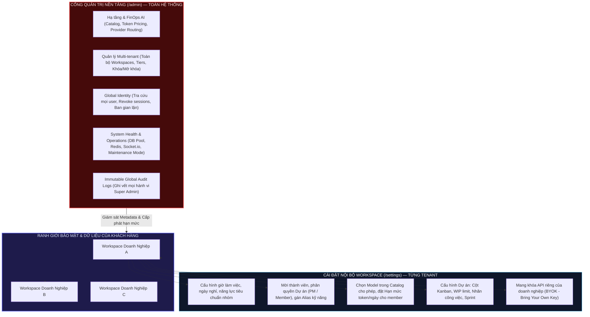

# 05 · Đặc tả Thiết kế Cổng Quản trị Nền tảng (Platform Super Admin)

> **Mục tiêu**: Xây dựng kiến trúc thông tin, trải nghiệm người dùng và đặc tả giao diện cho Cổng Quản trị Nền tảng (`/admin`) dành riêng cho đội ngũ vận hành sản phẩm SmartTask (Platform Operators, SRE, FinOps, Security & Super Admin).
> **Tiêu chuẩn áp dụng**: shadcn/ui · Radix UI · Tailwind CSS · Lucide Icons · WCAG 2.2 AA.

---

## 1. Tổng quan & Triết lý thiết kế

### 1.1 Sứ mệnh của Cổng Quản trị Nền tảng (`/admin`)
Trong hệ thống đa khách hàng (multi-tenant) của SmartTask:
- **Cài đặt Workspace** (`/settings` hoặc `/:workspaceSlug/settings`) phục vụ người quản trị từng công ty/nhóm (Workspace Owner / Admin) quản lý công việc và thành viên nội bộ.
- **Cổng Quản trị Nền tảng** (`/admin`) phục vụ nội bộ đội ngũ phát triển và vận hành SmartTask. Đây là "trung tâm điều hành không lưu" giám sát toàn vẹn hệ sinh thái, điều phối tài nguyên AI, kiểm soát chi phí API nhà cung cấp (FinOps), ứng phó sự cố bảo mật và bảo trì hạ tầng.

### 1.2 Bốn nguyên tắc thiết kế cốt lõi
1. **Safety-First & High Blast-Radius Awareness (An toàn trên hết)**:  
   Mọi thao tác ở Super Admin đều có thể ảnh hưởng tới hàng ngàn khách hàng. Bắt buộc có visual cues cảnh giới cao và hộp thoại xác nhận 2-3 lớp trước các thao tác phá hủy.
2. **Context Distinction & Zero Confusion (Phân tách ngữ cảnh triệt để)**:  
   Super Admin không bao giờ nhầm lẫn giữa việc đang dùng app thường ngày và việc đang can thiệp hệ thống sàn.
3. **FinOps & AI Transparency (Minh bạch chi phí AI)**:  
   AI là năng lực cốt lõi nhưng tốn kém nhất. Phải đo lường burn-rate, cache hit rate, chi phí từng model (Gemini, Claude, DeepSeek, OpenAI) theo thời gian thực.
4. **Zero Data Peeking (Bảo vệ riêng tư khách hàng - Privacy by Design)**:  
   Super Admin chỉ quản lý siêu dữ liệu (metadata), hạn mức, trạng thái thuê bao và nhật ký kiểm toán. Tuyệt đối không có giao diện xem trộm nội dung task/comment của khách hàng.

---

## 2. Đối chuẩn (Benchmarking) Nền tảng Đầu ngành

| Tiêu chí | Atlassian Admin (`admin.atlassian.com`) | Linear Admin | Supabase Management Console | Clerk Dashboard | **SmartTask Platform Admin (Đề xuất)** |
|:---|:---|:---|:---|:---|:---|
| **Mô hình kiến trúc** | Tách hẳn thành một domain độc lập hoàn toàn với Jira/Confluence. | Tích hợp trong app, mở modal/view riêng với theme tối cao cấp. | Bảng điều khiển hạ tầng Cloud chuyên sâu phân cấp theo Org -> Projects. | Bảng điều khiển IAM/Auth đa môi trường (Dev/Staging/Prod). | **Dedicated Route `/admin`** với Layout Shell riêng biệt, độc lập với AppShell của workspace. |
| **Nhận diện chế độ Admin** | Khá nhạt nhòa, icon logo Atlassian Admin xám, dễ nhầm khi mở nhiều tab. | Dựa vào role toggle và Command Menu (`Cmd+K`). | Thanh cảnh báo đỏ rực ở vùng Danger Zone, badge trạng thái dự án rõ rệt. | Tag môi trường nổi bật (Production viền vàng/đỏ), session banner. | **Header Neon Alert Bar (`border-b-2 border-destructive`)**, Huy hiệu nhấp nháy nhẹ `[ SUPER ADMIN ]`. |
| **Quản lý danh tính (IAM)** | Central directory, Atlassian Access, SAML/SCIM, Domain verification. | Quản lý người dùng theo Workspace, quyền Admin/Member/Guest. | Database Auth users, cấp JWT roles, reset auth provider. | Quản lý User sessions theo thời gian thực, IP/thiết bị, Revoke session 1-click. | **Global User Directory**: Tra cứu đa workspace, quản lý active refresh tokens, 1-click Revoke All Sessions, Ban fraud users. |
| **Kiểm soát hạ tầng & AI** | Giới hạn dung lượng Cloud, số user theo tier, không có AI FinOps sâu. | Quản lý tính năng AI theo workspace, cấu hình summarization. | Giám sát CPU/RAM, Database disk IOPS, Edge Function compute. | Không áp dụng (tập trung vào Auth & User management). | **Central AI Model Catalog & FinOps Engine**: Quản lý giá mua vào vs bán ra, Fallback routing (Gemini ↔ Claude ↔ DeepSeek), Burn-rate charts. |
| **Thao tác nguy hiểm (Destructive Actions)** | Gõ lại tên thực thể, xác nhận mật khẩu admin. | Dialog cảnh báo cơ bản, ít yêu cầu gõ chuỗi xác thực. | Bắt buộc gõ project-ref/tên dự án + popup cảnh báo hệ quả đỏ. | Nhập tên app / Confirm dialog với delay button 3 giây. | **Xác thực 3 cấp**: (1) Hiển thị tác động định lượng (Blast Radius) -> (2) Gõ đúng ID/Slug -> (3) Nhập mã 2FA TOTP. |

---

## 3. Ranh giới Bất khả Xâm phạm: Workspace Settings vs. Platform Super Admin



---

## 4. Kiến trúc Thông tin (Information Architecture)

```
/admin
├── / (Dashboard - Platform Overview)
│   ├── KPI Cards (Workspaces, Users, DAU/MAU, 30d AI Tokens, System Health)
│   ├── Charts (Tenant Growth, AI Cost Trend by Provider, Top Ten Workspace Consumers)
│   └── Incident & Security Feed
│
├── /workspaces (Multi-tenant Management)
│   ├── Filter & Data Table (Search, Tier, Status, AI Usage, Health)
│   ├── Modal/Sheet: Workspace Inspector (Metadata, Storage, Users, Cost)
│   ├── Drawer: Change Tier & Quota Allocation
│   └── Dialog: Suspend / Reactivate / Delete Workspace (Two-step guard)
│
├── /users (Global Identity & Users)
│   ├── Global Users Data Table (Email, Name, Verified, Global Role, Status)
│   ├── Sheet: User 360 Deep-Dive (Workspaces joined, Active Sessions, IP/Device)
│   ├── Action: Revoke All Sessions (Emergency kill-switch)
│   └── Dialog: Grant/Revoke Super Admin & Ban Account
│
├── /ai-finops (AI Infrastructure & FinOps Center)
│   ├── Tab 1: Model Catalog Manager (Providers, Pricing, Context window, Capabilities)
│   ├── Tab 2: Routing & Fallback Policies (Primary vs Fallback Providers for Tasks)
│   ├── Tab 3: Tier Quotas & Margins (Free, Pro, Enterprise default rules)
│   └── Tab 4: FinOps Observability (Daily/Weekly Burn-rate, Cache Hit Rate, Cost per Workspace)
│
├── /system (System Health & Infrastructure Operations)
│   ├── Cluster Status (PostgreSQL Pool, Redis/Cache, Socket.io Gateway, Cron Jobs)
│   ├── Maintenance Mode Controller (Global Toggle, Partial Toggle, Custom Banner)
│   └── Environment & Dependency Health (Supabase, Vercel proxy, Mailer, Push Service)
│
└── /audit-logs (Platform Audit Trail)
    ├── Filterable Audit Stream (Actor, Target entity, Action type, IP, Timestamp)
    ├── JSON Diff Inspector (Before vs After snapshot)
    └── Export Audit Data (CSV/JSON for compliance & ISO 27001)
```

---

## 5. Chi tiết các Phân hệ Chức năng

### 5.1 Dashboard Tổng quan Nền tảng (`/admin`)
- **5 KPI Cards**:
  1. Tổng Workspaces: `1,284` (1,150 Active, 94 Free, 38 Enterprise, 4 Suspended) · `+12.4% MoM`.
  2. Tổng Users Toàn cầu: `28,450` Users (14,200 DAU, 23,800 MAU, DAU/MAU 59.6%).
  3. Lượng Token AI 30 ngày: `842.6M` Tokens (Chi phí gốc: `$1,428.50 USD`, Tiết kiệm từ Cache: `28.4%`).
  4. Biên Lợi nhuận AI: `+68.5%` Gross Margin từ gói cước.
  5. Sức khỏe Hệ thống: `99.98% Uptime` · DB Pool: 42/100 conns · Redis latency: 1.2ms · 3,420 Active Sockets.
- **Biểu đồ Chi phí AI Burn-rate**: Line & Stacked Area theo từng Provider (Gemini, Claude, OpenAI, DeepSeek).
- **Top 5 Workspaces tiêu thụ tài nguyên lớn nhất**: Bảng theo dõi quota sát nút.

### 5.2 Quản lý Tổ chức & Workspace (`/admin/workspaces`)
- Bộ lọc đa chiều: Tìm kiếm theo Tên, Slug, UUID, Email Owner; Lọc theo Tier (Free, Pro, Enterprise), Trạng thái (Active, Suspended, Delinquent, Archived).
- DataTable tương thích TanStack Table: Cột Workspace, Owner, Tier, Quy mô (Members/Limit, Projects), AI Tokens 30d, Ngày tạo, Trạng thái, Action Dropdown.
- Workspace Sheet Inspector: Xem metadata, dung lượng storage tệp đã chiếm dụng, danh sách admin/members.
- Hành động can thiệp: Tạm khóa (Suspend) với lý do, Mở khóa (Reactivate), Gửi cảnh báo vi phạm SLA/ToS, Nâng/hạ gói cước.

### 5.3 Quản lý Người dùng Toàn cầu (`/admin/users`)
- Danh bạ User toàn sàn: Tra cứu theo email, tên, IP đăng nhập cuối cùng.
- User Deep-Dive Sheet:
  - Bảng các workspace mà user đang tham gia và vai trò tại từng nơi.
  - Quản lý các phiên đăng nhập (Active Refresh Tokens) hiển thị IP, thiết bị, thời gian tạo.
  - Nút **"Cưỡng chế Đăng xuất Mọi Thiết bị" (Revoke All Sessions)**: Xóa sạch token trong bảng `refresh_tokens`.
  - Khóa tài khoản vĩnh viễn (Fraud Ban) khi phát hiện hành vi phá hoại hoặc spam.
  - Cấp/hủy quyền Super Admin kèm lý do và xác nhận 2FA.

### 5.4 Hạ tầng AI & Trung tâm Chi phí Toàn hệ thống (`/admin/ai-finops`)
- Quản trị trực tiếp bảng `ai_model_catalog`:
  - Thêm mới/cập nhật model từ Google Gemini, Anthropic Claude, OpenAI, DeepSeek, Ollama.
  - Cấu hình giá mua gốc (Input/Output/Cached per 1M tokens) vs giá bán quy đổi theo điểm tín dụng.
  - Bật/tắt các cờ năng lực: `supports_structured_output`, `is_reasoning`, `supports_vision`, `cache_mode`.
- Ma trận Fallback Routing tự động:
  - `DECOMPOSE`: Primary `gemini-2.5-flash` → Fallback 1 `deepseek-chat` → Fallback 2 `ollama:qwen2.5:7b`.
  - `ASSIGN`: Primary `gemini-2.5-flash` → Fallback 1 `claude-3-5-haiku`.
  - `CHAT`: Primary `claude-3-5-sonnet` → Fallback 1 `gemini-2.5-pro`.
- Cơ chế FinOps Burn-rate & Quota Alerts:
  - Dự báo hóa đơn cuối tháng theo Run-rate.
  - Giới hạn hạn mức mặc định theo Tier (Free 20 calls/day; Pro 100 calls/day; Enterprise customized).

### 5.5 Vận hành & Giám sát Hệ thống (`/admin/system`)
- Topology Health Check: Giám sát trực quan PostgreSQL PgBouncer connections, Redis latency, Socket.io connected sockets, Cron scheduler status.
- Bộ Điều khiển Chế độ Bảo trì (Maintenance Mode Controller):
  - Bật/tắt chế độ bảo trì toàn hệ thống hoặc chỉ bảo trì cụm tính năng AI/ghi dữ liệu.
  - Soạn thảo thông điệp bảo trì và thời gian dự kiến hoàn thành hiển thị tới người dùng toàn sàn.
  - Whitelist IP của SRE và Super Admin bypass.

### 5.6 Nhật ký Kiểm toán Toàn hệ thống (`/admin/audit-logs`)
- Lưu trữ mọi hành vi của Super Admin: Timestamp, Actor, Action Type, Target Entity, IP, User-Agent, và JSON Diff (Before vs After).
- Xuất file CSV/JSON phục vụ tuân thủ bảo mật và đánh giá an toàn thông tin định kỳ.

---

## 6. Công thái học & Tín hiệu An toàn (Safety Ergonomics)

### 6.1 Nhận diện Thị giác Chế độ Super Admin
- Header viền đỏ thẫm `border-b-2 border-destructive` chạy dọc toàn màn hình.
- Huy hiệu neon `[ PLATFORM SUPER ADMIN ]` nhấp nháy nhẹ tại Topbar.
- Banner cảnh báo liên tục: *"Mọi tương tác trong chế độ Super Admin đều được mã hóa và lưu vào Nhật ký Kiểm toán Bất biến."*
- Nút "Quay lại Workspace cá nhân" giúp thoát nhanh chế độ quản trị.
- Tự động khóa màn hình (Auto-lock) sau 15 phút không hoạt động.

### 6.2 Quy trình Xác nhận Phá hủy 2-3 Lớp
Mọi hành động hủy hoại (Xóa workspace, Khóa tài khoản, Bật bảo trì toàn sàn) tuân theo:
1. **Lớp 1 - Đánh giá Tác động (Blast Radius)**: Hiển thị số lượng user, task, cron job bị ảnh hưởng.
2. **Lớp 2 - Gõ Chuỗi Định danh Khớp Tuyệt đối**: Yêu cầu gõ chính xác chuỗi `khoa acme-corp` hoặc `xoa vinh vien tenant-123`. Nút submit bị vô hiệu hóa cho đến khi khớp 100%.
3. **Lớp 3 - Xác thực 2FA TOTP**: Nhập mã 6 số từ ứng dụng Google Authenticator / 1Password của Super Admin.
4. **Bắt buộc nhập Lý do Nghiệp vụ (Reason)**: Tối thiểu 10 ký tự để lưu vào Audit Log trước khi API thực thi.

---

## 7. Lộ trình Triển khai Kỹ thuật

- **Milestone 1 (Tuần 09)**: Khung giao diện `AdminShell` + Dashboard Overview + Quản lý Workspace & Hộp thoại xác nhận 2 lớp.
- **Milestone 2 (Tuần 10)**: Quản lý Người dùng Toàn cầu & Kill Session + Hạ tầng AI Model Catalog & FinOps Burn-rate.
- **Milestone 3 (Tuần 11)**: Sức khỏe Hệ thống + Bộ điều khiển Chế độ Bảo trì + Nhật ký Kiểm toán Bất biến (Audit Logs).
