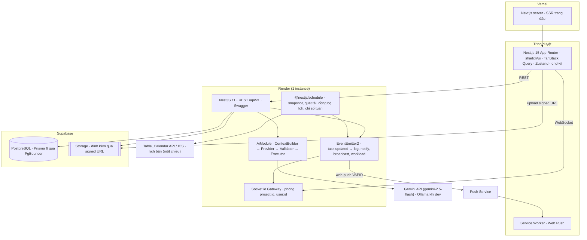
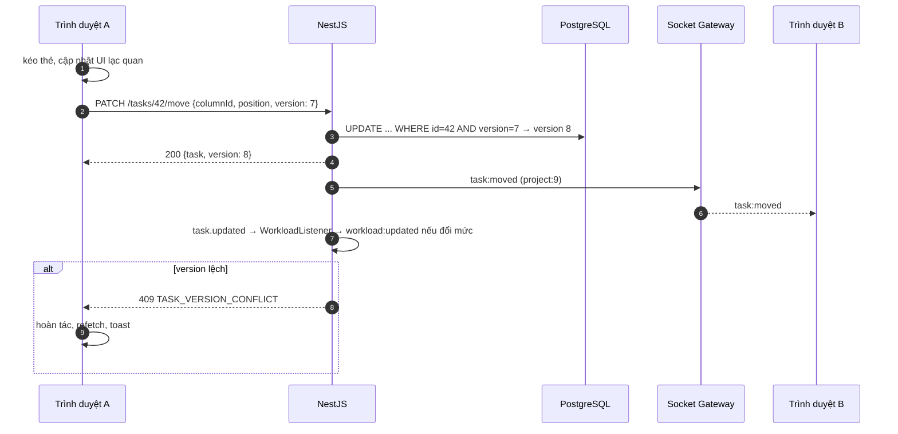

# 01 · Kiến trúc hệ thống

## 1. Kiến trúc triển khai

Ba tầng tách biệt, mỗi tầng một nhà cung cấp miễn phí. **API NestJS là nguồn sự thật duy nhất**: giao diện, socket, cron và AI đều đi qua cùng lớp service, nên quy tắc nghiệp vụ chỉ viết một lần.



| Thành phần | Vai trò | Ghi chú vận hành |
|---|---|---|
| Next.js trên Vercel | SSR trang dashboard đầu tiên, các màn tương tác là client component; proxy `/api` để cùng origin | HTTPS sẵn (cần cho Web Push); preview deployment cho mỗi PR |
| NestJS trên Render | REST + Socket.io + cron + AI trong **một tiến trình** — đủ cho một instance, không cần Redis | Ngủ sau 15 phút không request → UptimeRobot ping `/api/health` mỗi 10 phút, đánh thức 30 phút trước demo |
| PostgreSQL trên Supabase | Prisma qua pooler (`DATABASE_URL`, cổng 6543) cho runtime; `DIRECT_URL` (5432) cho migrate | Dự án free bị tạm dừng sau 7 ngày không hoạt động → cron ping hằng ngày; `pg_dump` hằng tuần |
| Supabase Storage | Tệp đính kèm; trình duyệt upload thẳng bằng signed URL do API cấp | Giới hạn 10 MB/tệp |
| Gemini API | Phân rã, phân công, giải thích; structured output theo `responseSchema` | Free tier ~10–15 RPM → cache, hạn mức/người/ngày; Ollama (`qwen2.5:7b`) khi dev offline |
| Lịch ngoài | Cron kéo khoảng *bận* từ Table_Calendar API hoặc ICS; chỉ lưu khung giờ, không lưu nội dung | Một chiều; xoá khi ngắt kết nối |

## 2. Tầng bên trong API

```
Controller (DTO, class-validator whitelist)  →  Service (nghiệp vụ, Prisma)  →  PostgreSQL
        │                                          │
        │ Guards: JwtAuth → WorkspaceRole → ProjectMember
        │                                          └─ phát sự kiện nội bộ (EventEmitter2)
        │                                                  ├─ ActivityLogListener   → activity_logs
        │                                                  ├─ NotificationListener  → notifications, web-push
        │                                                  ├─ RealtimeListener      → Socket.io rooms
        │                                                  └─ WorkloadListener      → tính lại tải, phát workload:updated
        └─ Filter lỗi thống nhất { code, message, details }   (mã lỗi trong packages/shared)
```

Nguyên tắc:

1. Controller không chứa nghiệp vụ; Service không biết đến socket hay push — chúng chỉ phát sự kiện.
2. Hàm tính toán thuần (`workload/`, `forecast/`, `ai/validator`) không phụ thuộc DB để test đơn vị được; service nạp dữ liệu rồi gọi hàm thuần.
3. Kiểm tra quyền theo **dữ liệu** (task thuộc dự án nào, người gọi có trong `project_members` không) — không tin `workspaceId`/`projectId` gửi từ client.
4. Định danh luôn từ `req.user` (JWT); body không bao giờ mang `userId` của người gọi (`~/Table_Calendar/docs/ai-scheduling-architecture/01-target-architecture.md`, mục Authorization).
5. Mọi ghi dữ liệu do AI đề xuất đi qua **cùng service** mà giao diện dùng (`TasksService.create/assign/move`) — thông báo, activity log, realtime, tính tải chạy y hệt thao tác tay.

## 3. Realtime

- Client **không ghi qua socket**; ghi qua REST, API ghi DB rồi phát sự kiện tới phòng `project:{id}`; thông báo cá nhân qua phòng `user:{id}`.
- Mỗi task có `version`; `PATCH /tasks/:id/move` gửi `version` hiện có → 0 dòng cập nhật = 409 `TASK_VERSION_CONFLICT`, client hoàn tác và tải lại.
- Cập nhật lạc quan ở client (dnd-kit) với vị trí phân số; chuẩn hoá lại khi khoảng cách < 1e-6.
- Sau reconnect: `GET /projects/:id/tasks?since=<lastEventAt>` lấy phần chênh.
- Handshake socket mang access token; hết hạn → refresh rồi reconnect. Join phòng dự án chỉ khi là thành viên (kiểm tra ở gateway).



## 4. Quyết định công nghệ (ADR rút gọn)

| Quyết định | Chọn | Thay thế đã cân nhắc | Lý do · hệ quả |
|---|---|---|---|
| Backend | NestJS 11 + Prisma 6 | Express | Module/DI/Guard, Swagger tự sinh (giao phẩm Tuần 06), gateway Socket.io tích hợp; nhóm đã dùng ở Table_Calendar |
| Frontend | Next.js 15 App Router + TypeScript | Vite SPA | Đề bài yêu cầu; **không** dùng Server Actions để ghi — mọi ghi qua NestJS để socket phát được |
| UI kit | shadcn/ui + Tailwind v4 + Radix, `next-themes` | MUI, Ant | Component sao chép vào repo, sửa tự do; accessibility sẵn; shadcn Charts (Recharts) cho tải/burn-down |
| Xác thực | JWT tự quản (access 15', refresh 7 ngày cookie httpOnly), bcrypt | Supabase Auth | Một nguồn sự thật `users`, dễ trình bày khi bảo vệ |
| Realtime | Socket.io gateway trong NestJS | Supabase Realtime | Sự kiện mang ngữ nghĩa nghiệp vụ (actor, version), presence, kiểm quyền khi join |
| CSDL | PostgreSQL trên Supabase | Neon | Có Storage cùng nơi; Neon là dự phòng |
| Kéo thả | @dnd-kit | react-beautiful-dnd | Bàn phím, không phụ thuộc DOM |
| AI | `@google/genai` + `responseSchema`; lớp `AiProvider` (gemini \| ollama) | LangChain | Structured output loại lỗi parse; đổi model bằng cấu hình; không thêm phụ thuộc lớn |
| Push | `web-push` VAPID + Service Worker | FCM SDK | Chuẩn W3C; chỉ HTTPS; không demo iOS |
| Nền | `@nestjs/schedule` + EventEmitter2 | BullMQ + Redis | Không có Redis miễn phí; snapshot chạy lại được |
| Triển khai | Vercel + Render + Supabase, GitHub Actions | Railway | Đúng gợi ý đề bài; Railway là phương án B |

## 5. Bảo mật & phi chức năng

- bcrypt cost 12; refresh token xoay vòng, lưu hash để thu hồi; helmet; CORS chỉ origin Vercel; throttler 100 req/phút/IP, 10 req/phút cho login.
- `ValidationPipe({ whitelist: true, forbidNonWhitelisted: true })`; Prisma tham số hoá; markdown sanitize (rehype-sanitize).
- Tệp: kiểm MIME + ≤ 10 MB; tải qua signed URL 15 phút.
- Khoá API AI mã hoá AES-GCM bằng `APP_KEY` trước khi lưu `ai_configs.api_key_encrypted`.
- Mục tiêu đo: API p95 < 300 ms đọc / < 500 ms ghi; realtime ≤ 500 ms; Kanban 200 thẻ mượt; AI phân rã ≤ 15 s, JSON hợp lệ ≥ 95%; coverage ≥ 80% cho module thuật toán.
