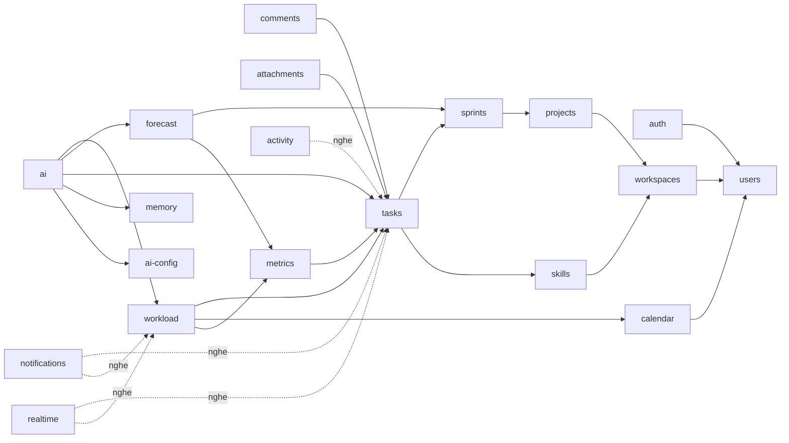

# 02 · Danh sách module

## 1. Backend — `apps/api/src`

| Module | Trách nhiệm | Bảng chính | Phát sự kiện | Nghe sự kiện | UC |
|---|---|---|---|---|---|
| `auth` | Đăng ký, đăng nhập, refresh/logout, Passport-JWT, guards | users, refresh_tokens | `user.registered` | — | 01, 02 |
| `users` | Hồ sơ, năng lực giờ/tuần, ngày nghỉ, tuỳ chọn thông báo | users, user_time_off | `user.updated` | — | 03, 07 |
| `workspaces` | Workspace, thành viên, vai trò, lời mời, cấu hình (ngưỡng tải, trọng số) | workspaces, workspace_members, invitations | `member.added/removed` | — | 04, 05 |
| `skills` | Danh mục kỹ năng, alias kỹ năng, kỹ năng cá nhân (mức 1–5, xác nhận), heatmap | skills, skill_aliases, user_skills | `skill.updated` | — | 06, 22, 23 |
| `projects` | Dự án, thành viên dự án, PM, cột Kanban, nhãn | projects, project_members, board_columns, labels | `project.updated` | — | 08 |
| `sprints` | Vòng đời sprint (một ACTIVE/dự án), đóng sprint chuyển việc dở, snapshot burn-down | sprints, burndown_snapshots | `sprint.started/closed` | `task.updated` (cập nhật scope) | 09, 30 |
| `tasks` | Task/subtask CRUD, gán người, kỹ năng yêu cầu, phụ thuộc, move có version, danh sách/bộ lọc | tasks, task_assignees, task_skills, task_dependencies, task_labels | `task.created/updated/moved/deleted/assigned` | — | 10, 11, 12, 13, 14, 15 |
| `comments` | Bình luận, @mention, sửa/xoá | comments, mentions | `comment.created`, `user.mentioned` | — | 18 |
| `attachments` | Ký URL upload, ghi metadata, xoá tệp | attachments | `attachment.added` | — | 19 |
| `notifications` | Tạo thông báo in-app, đếm chưa đọc, Web Push (subscription, gửi, dọn 410) | notifications, push_subscriptions | `notification.created` | `task.assigned`, `user.mentioned`, `workload.alert`, `sprint.*`, `ai.proposal.applied` | 20, 21 |
| `activity` | Nhật ký thay đổi (ai, lúc nào, trường nào, cũ/mới) | activity_logs | — | mọi `task.*`, `comment.*`, `sprint.*` | 16 |
| `workload` | **Chỉ tính**: giờ còn lại theo tuần, năng lực hiệu dụng, mức sử dụng, điểm burnout, giờ trống theo ngày, chỉ số công bằng; snapshot; cảnh báo | workload_snapshots, workload_alerts | `workload.updated`, `workload.alert` | `task.*`, `calendar.changed`, `user.updated`, cron 07:00 | 24, 25 |
| `metrics` | Chỉ số lịch sử cá nhân theo tuần: EAR, vận tốc, đúng hạn, rating, cycle time; giờ thực tế; đánh giá task | time_entries, task_reviews, user_metrics_weekly | `metrics.recomputed` | `task.completed`, cron chủ nhật | 35, 36 |
| `forecast` | **Chỉ tính**: đường lý tưởng/thực tế, vận tốc, ETA, mức rủi ro theo ngưỡng, danh sách nguyên nhân đo được | burndown_snapshots | `forecast.risk.changed` | cron 00:05 | 30, 31 |
| `calendar` | `CalendarProvider` (Table_Calendar \| ICS \| tay); đồng bộ khoảng bận; giờ họp theo ngày | calendar_connections, calendar_events | `calendar.changed` | cron 30 phút | 37 |
| `ai` | ContextBuilder → PromptAssembler → Provider (gemini \| ollama) → ActionValidator → Executor; phiên chat; đề xuất; phản hồi; hạn mức | chat_sessions, chat_messages, ai_proposals, ai_feedback, ai_token_logs | `ai.proposal.created/applied` | — | 28, 29, 31, 32, 38, 39 |
| `ai-config` | Catalog model & năng lực, cấu hình theo mục đích, prompt MASTER/WORKSPACE có phiên bản, prompt cá nhân, cache, trace | ai_model_catalog, ai_configs, ai_prompt_configs, ai_personal_prompts | `ai.config.changed` | — | 40 |
| `memory` | Trí nhớ cá nhân (đề xuất → xác nhận), thói quen suy ra từ phản hồi, bật/tắt | ai_memories, ai_habits | — | `ai.feedback.recorded` | 38, 39 |
| `realtime` | Socket.io gateway: xác thực handshake, join phòng theo quyền, presence, phát sự kiện | — | — | `task.*`, `comment.created`, `notification.created`, `workload.updated` | 17 |
| `dashboard` | Truy vấn tổng hợp cho dashboard dự án/workspace | — | — | — | 33 |
| `health` | `/health` (tiến trình), `/health/ready` (DB) | — | — | — | — |
| `common` | Guards, decorators (`@CurrentUser`, `@Roles`), filter lỗi, interceptor, `packages/shared` mã lỗi | — | — | — | — |

Quy ước thư mục mỗi module (theo `~/Table_Calendar/apps/api/src/admin/*`):

```
tasks/
├── tasks.module.ts
├── tasks.controller.ts        # DTO + Swagger decorators
├── tasks.service.ts           # nghiệp vụ, Prisma, phát sự kiện
├── tasks.listener.ts          # (nếu có) nghe sự kiện module khác
├── dto/ create-task.dto.ts, move-task.dto.ts, ...
├── domain/ position.ts        # hàm thuần: vị trí phân số, kiểm tra vòng phụ thuộc
└── tasks.service.spec.ts, position.spec.ts
```

## 2. Frontend — `apps/web`

| Feature (`features/*`) | Màn hình / route | Component shadcn chính | Dữ liệu |
|---|---|---|---|
| `auth` | `(auth)/login`, `register`, `invite/[token]` | Card, Form, Input, Sonner | `POST /auth/*` |
| `shell` | `(app)/w/[wsSlug]/layout` — Sidebar, Breadcrumb, ⌘K, chuông | Sidebar, Command, Popover, Avatar | `GET /me`, `/notifications` |
| `workspace` | `members/`, `skills/`, `settings/` | Table, Dialog, Combobox, Slider | `/workspaces/:id/*` |
| `projects` | `p/[key]/` tổng quan, `sprints/` | Card, Accordion, AlertDialog, Calendar | `/projects/:id`, `/sprints` |
| `board` | `p/[key]/board` Kanban | Card, Badge, ScrollArea, ContextMenu + dnd-kit | `GET tasks?view=kanban`, socket |
| `tasks` | Sheet chi tiết `t/[taskKey]` (intercepting route); list `list/` | Sheet, Tabs, Combobox, Calendar, Slider, Progress, DataTable | `/tasks/:id`, `/comments`, `/attachments` |
| `gantt` | `p/[key]/gantt` (chỉ đọc; kéo giãn là Should) | ScrollArea, Tooltip, ToggleGroup, Resizable | cùng query `tasks` |
| `matrix` | `p/[key]/matrix` Eisenhower 2×2 | Card, Badge, Switch + dnd-kit droppable | cùng query `tasks` |
| `workload` | `w/[ws]/workload`, `p/[key]/workload` | Chart (Bar stacked), Sheet, Alert, Progress | `/workload`, socket `workload:updated` |
| `progress` | `p/[key]/progress` burn-down, dự báo | Chart (Line/Area), Card, Alert | `/sprints/:id/burndown`, `/forecast` |
| `ai` | `p/[key]/ai` trợ lý: chat theo phiên + thẻ đề xuất (xem trước, sửa, áp dụng) | Dialog/Sheet, Textarea, Table (chỉnh tại chỗ), Skeleton, Alert | `/ai/chat`, `/ai/proposals/:id/apply` |
| `memory` | `me/ai` — điều AI ghi nhớ, thói quen đã học, prompt cá nhân | Table, Switch, Textarea | `/me/ai/memories`, `/habits`, `/personal-prompt` |
| `notifications` | Popover chuông; `me/notifications` | Popover, ScrollArea, Badge, Switch | `/notifications`, `/push/subscriptions` |
| `admin-ai` | `w/[ws]/settings/ai` — catalog model, cấu hình theo mục đích, prompt workspace, sổ token & chi phí | DataTable, Form, Tabs, Chart | `/ai-config/*` |

Quy ước dữ liệu: TanStack Query là cache duy nhất cho dữ liệu server (socket chỉ `setQueryData`/`invalidate`); Zustand chỉ giữ trạng thái giao diện; kiểu và zod schema dùng chung ở `packages/shared`; ba chế độ xem (Kanban/Gantt/Eisenhower) đọc **cùng một query** `tasks(projectId, filters)`.

## 3. Gói dùng chung — `packages/shared`

- `types/`: DTO trả về của API (sinh từ OpenAPI bằng `openapi-typescript` ở Tuần 07).
- `schemas/`: zod schema cho form và cho validator AI (`decomposeProposalSchema`, `assignProposalSchema`).
- `errors.ts`: mã lỗi (`TASK_VERSION_CONFLICT`, `WIP_LIMIT_EXCEEDED`, `AI_QUOTA_EXCEEDED`, `ASSIGN_CAPACITY_EXCEEDED`, …) + thông điệp tiếng Việt.
- `constants.ts`: ngưỡng mặc định (xem 04).

## 4. Sơ đồ phụ thuộc module backend



Mũi tên liền = gọi service trực tiếp; mũi tên đứt = chỉ nghe sự kiện (không import service) — tránh phụ thuộc vòng.
