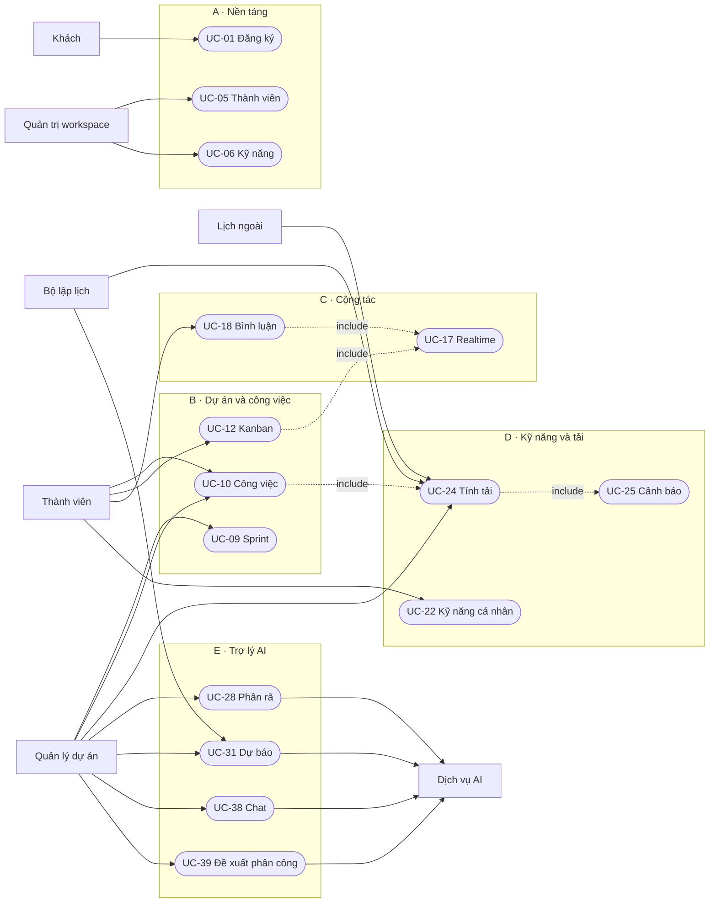

# 03 · Use case

Phân loại theo hướng dẫn xác định chi phí phần mềm nội bộ (Công văn 2589/BTTTT-ƯDCNTT): tác nhân Đơn giản (API) / Trung bình (giao thức) / Phức tạp (GUI); use case theo số giao dịch: Đơn giản ≤ 3, Trung bình 4–7, Phức tạp ≥ 8. Ưu tiên MoSCoW: **M** Must (24), **S** Should (13), **C** Could (4). Nhãn giao dịch: ĐV đầu vào · ĐR đầu ra · TQ tra cứu · TV truy vấn · DB cơ sở dữ liệu.

## 1. Tác nhân

| TT | Tác nhân | Mô tả | Loại |
|---|---|---|---|
| 1 | Khách | Đăng ký, đăng nhập, nhận lời mời | Phức tạp |
| 2 | Thành viên | Làm việc được giao, kéo thả, bình luận, khai kỹ năng, xem tải của mình, chat với trợ lý | Phức tạp |
| 3 | Quản lý dự án (PM) | Dự án, sprint, giao việc, dùng AI, theo dõi tải/burn-down, xử lý cảnh báo, xác nhận kỹ năng | Phức tạp |
| 4 | Quản trị workspace | Workspace, thành viên, vai trò, danh mục kỹ năng, cấu hình AI, ngưỡng tải | Phức tạp |
| 5 | Dịch vụ AI (Gemini / Ollama) | Nhận ngữ cảnh, trả structured action | Đơn giản |
| 6 | Dịch vụ Web Push | Nhận subscription, đẩy thông báo | Trung bình |
| 7 | Bộ lập lịch | Snapshot, quét tải, đồng bộ lịch, chỉ số tuần | Đơn giản |
| 8 | Kho tệp (Supabase Storage) | Signed URL | Đơn giản |
| 9 | Hệ thống lịch ngoài (Table_Calendar / ICS) | Cung cấp khoảng bận | Đơn giản |

## 2. Bảng use case

### A · Nền tảng & workspace

| Mã | Use case | Tác nhân | Giao dịch chính | GD | Ưu tiên |
|---|---|---|---|---|---|
| UC-01 | Đăng ký | Khách | nhập email/mật khẩu/tên [ĐV]; kiểm trùng [TV]; tạo tài khoản [DB] | 3 | M |
| UC-02 | Đăng nhập / đăng xuất / làm mới phiên | Mọi người dùng | cấp access+refresh [ĐV]; từ chối tài khoản khoá [ĐV]; refresh [ĐV]; thu hồi [DB]; ghi thời điểm [DB] | 5 | M |
| UC-03 | Hồ sơ cá nhân | Mọi người dùng | xem [TQ]; sửa tên/ảnh/múi giờ [ĐV]; đổi mật khẩu [ĐV]; kênh thông báo [ĐV] | 4 | M |
| UC-04 | Quản lý workspace | Owner/Admin | tạo [ĐV]; sửa [ĐV]; chuyển sở hữu [ĐV]; lưu trữ [DB]; danh sách của tôi [TQ] | 5 | M |
| UC-05 | Thành viên workspace | Owner/Admin/Khách | mời [ĐV]; gửi lời mời [ĐR]; chấp nhận [ĐV]; đổi vai [ĐV]; gỡ [DB]; danh sách [TQ] | 6 | M |
| UC-06 | Danh mục kỹ năng | Admin | xem theo nhóm [TQ]; thêm/sửa/ẩn [ĐV]; gộp trùng + alias [DB]; nạp bộ mẫu [DB] | 4 | M |
| UC-07 | Năng lực làm việc | Admin/PM/Thành viên | giờ/tuần mặc định [ĐV]; riêng từng người [ĐV]; ngày nghỉ [ĐV] | 3 | S |

### B · Dự án & công việc

| Mã | Use case | Tác nhân | Giao dịch chính | GD | Ưu tiên |
|---|---|---|---|---|---|
| UC-08 | Quản lý dự án | Admin/PM | tạo, mã dự án [ĐV]; sửa, lưu trữ [ĐV]; thành viên, PM [ĐV]; danh sách [TQ]; tổng quan [TQ] | 5 | M |
| UC-09 | Sprint / phase | PM | tạo [ĐV]; kéo backlog vào [ĐV]; bắt đầu (một ACTIVE) [ĐV]; kết thúc, chuyển việc dở [DB]; danh sách [TQ] | 5 | M |
| UC-10 | Công việc | PM/Thành viên | tạo đủ trường (gồm **loại** STORY/TASK/BUG) [ĐV]; giao người [ĐV]; sửa/xoá mềm [ĐV]; mã ST-n [DB]; chi tiết — modal và trang riêng `/tasks/ST-n` [TQ]; tiến độ/giờ còn lại [ĐV]; sao chép [ĐV]; version [DB] | 8 | M |
| UC-11 | Subtask & phụ thuộc | PM/Thành viên | subtask [ĐV]; tiến độ cha [DB]; bị chặn bởi [ĐV]; phát hiện vòng [TV]; huy hiệu bị chặn [ĐR] | 5 | M (subtask) · S (phụ thuộc) |
| UC-12 | Kanban | PM/Thành viên/Viewer | bảng theo cột [TQ]; kéo thả [ĐV]; cột & WIP [ĐV]; cảnh báo WIP [ĐR]; lọc/tìm [TV]; tạo nhanh [ĐV]; nhóm theo người/ưu tiên [TQ]; chọn nhiều + thao tác hàng loạt [ĐV]; huy hiệu quá hạn/bị chặn/quá tải [ĐR] | 9 | M |
| UC-13 | Gantt | PM/Thành viên | thanh theo ngày [ĐR]; hôm nay/quá hạn [ĐR]; mũi tên phụ thuộc [ĐR]; thu phóng [TV]; kéo giãn [ĐV] | 5 | M (đọc) · S (kéo) |
| UC-14 | Eisenhower | PM/Thành viên | 4 góc [ĐR]; kéo đổi ưu tiên/khẩn [ĐV]; việc của tôi [TV] | 3 | S |
| UC-15 | Danh sách & bộ lọc | Mọi người dùng | bảng, sắp xếp, sửa tại chỗ [TQ/ĐV]; bộ lọc lưu (URL + đặt tên) [TV]; tìm toàn văn [TV]; backlog riêng [TQ]; việc của tôi xuyên dự án [TQ] | 6 | M |
| UC-16 | Nhật ký hoạt động | Mọi người dùng | ghi diff [DB]; lịch sử task [TQ]; dòng hoạt động dự án [TQ] | 3 | S |

### C · Cộng tác thời gian thực

| Mã | Use case | Tác nhân | Giao dịch chính | GD | Ưu tiên |
|---|---|---|---|---|---|
| UC-17 | Đồng bộ realtime | Mọi người dùng, Hệ thống | join/leave phòng [ĐV]; phát task.* [ĐR]; optimistic + hoàn tác [ĐV]; 409 version [TV]; presence [ĐR]; reconnect + since [TV] | 6 | M |
| UC-18 | Bình luận & @mention | PM/Thành viên | markdown [ĐV]; gợi ý @ [TV]; sửa/xoá [ĐV]; mention → thông báo [DB]; phát realtime [ĐR] | 5 | M |
| UC-19 | Đính kèm | PM/Thành viên | signed URL ≤ 10 MB [ĐV]; xem trước/tải [ĐR]; xoá [DB]; liệt kê [TQ] | 4 | M |
| UC-20 | Trung tâm thông báo | Mọi người dùng | sinh theo sự kiện [DB]; đếm chưa đọc realtime [ĐR]; đọc/đọc tất cả [ĐV]; điều hướng [TV] | 4 | M |
| UC-21 | Web Push | Mọi người dùng, Push | đăng ký SW [ĐV]; lưu subscription [DB]; gửi VAPID [ĐR]; huỷ, dọn 410 [DB] | 4 | S |

### D · Kỹ năng & cân bằng tải

| Mã | Use case | Tác nhân | Giao dịch chính | GD | Ưu tiên |
|---|---|---|---|---|---|
| UC-22 | Kỹ năng cá nhân | Thành viên/PM | chọn, mức 1–5 [ĐV]; PM xác nhận [ĐV]; lịch sử [DB]; xem [TQ] | 4 | M |
| UC-23 | Ma trận kỹ năng nhóm | PM/Admin | heatmap [ĐR]; lọc ≥ N [TV]; bus factor [ĐR] | 3 | M |
| UC-24 | Tính khối lượng công việc | Hệ thống/PM/Thành viên | giờ còn lại theo tuần [DB]; so năng lực → % [TV]; biểu đồ [ĐR]; chi tiết cấu thành [TQ]; tính lại khi đổi [ĐR] | 5 | M |
| UC-25 | Cảnh báo quá tải & burnout | Hệ thống/PM/Thành viên | ngưỡng khi đổi & mỗi sáng [DB]; điểm burnout [TV]; huy hiệu [ĐR]; thông báo [ĐR]; ghi nhận xử lý [ĐV] | 5 | M |
| UC-26 | Bảng năng lực khi giao việc | Hệ thống/PM | khớp kỹ năng từng người [TV]; giờ trống trước hạn [TV]; hiển thị bảng sự thật cạnh Combobox giao việc [ĐR] — **không xếp hạng** | 3 | S |
| UC-27 | Cân bằng lại tải | PM | kéo task giữa người trên biểu đồ [ĐV]; xem trước tải mới [ĐR]; áp dụng [DB] | 3 | C |

### E · Trợ lý AI

| Mã | Use case | Tác nhân | Giao dịch chính | GD | Ưu tiên |
|---|---|---|---|---|---|
| UC-28 | AI phân rã yêu cầu | PM, Dịch vụ AI | nhập yêu cầu, sprint, mức chi tiết [ĐV]; nạp ngữ cảnh [TV]; gọi AI theo schema [ĐR]; kiểm tra hợp lệ [TV]; lưu nháp [DB]; xem trước/sửa [ĐV]; tạo hàng loạt [DB]; thông báo + realtime [ĐR] | 8 | M |
| UC-29 | AI ước lượng lại | PM, Dịch vụ AI | chọn task [ĐV]; so sánh cũ/mới, lý do [ĐR]; áp dụng [ĐV] | 3 | C |
| UC-30 | Burn-down & vận tốc | Hệ thống/PM | snapshot 00:05 [DB]; lý tưởng/thực tế [ĐR]; vận tốc [ĐR]; đánh dấu scope creep [ĐR] | 4 | M |
| UC-31 | Dự báo rủi ro trễ hạn | Hệ thống/PM, Dịch vụ AI | ETA [TV]; mức rủi ro theo ngưỡng [TV]; nguyên nhân đo được [TQ]; AI giải thích + khuyến nghị [ĐR]; thông báo khi tăng [ĐR] | 5 | M |
| UC-32 | Nhật ký & hạn mức AI | Hệ thống/Admin | ghi token, thời gian, hash [DB]; hạn mức/người/ngày [TV]; cache kết quả [DB] | 3 | S |

### F · Báo cáo

| Mã | Use case | Tác nhân | Giao dịch chính | GD | Ưu tiên |
|---|---|---|---|---|---|
| UC-33 | Dashboard dự án | PM/Thành viên/Viewer | thẻ số [TQ]; việc theo trạng thái/người [ĐR]; tải & cảnh báo [ĐR]; burn-down thu nhỏ [ĐR] | 4 | M |
| UC-34 | Xuất báo cáo sprint | PM | CSV [ĐR]; PDF [ĐR] | 2 | C |

### G · Bổ sung cho AI giao việc

| Mã | Use case | Tác nhân | Giao dịch chính | GD | Ưu tiên |
|---|---|---|---|---|---|
| UC-35 | Giờ làm thực tế | Thành viên/Hệ thống | nhập giờ theo ngày [ĐV]; cycle time từ chuyển trạng thái [DB]; tổng tuần [TQ] | 3 | S |
| UC-36 | Đánh giá task sau hoàn thành | PM/Hệ thống | rating, độ khó, giờ thực [ĐV]; nhắc [ĐR]; cron chỉ số tuần [DB] | 3 | S |
| UC-37 | Kết nối lịch bận | Thành viên/Hệ thống/Lịch ngoài | nhập tay [ĐV]; ICS 30 phút [DB]; adapter Table_Calendar [DB]; giờ họp trên biểu đồ [ĐR]; ngắt [DB] | 5 | S · C (adapter) |
| UC-38 | Chat với trợ lý theo phiên | PM/Thành viên, Dịch vụ AI | phiên theo dự án [ĐV]; structured action [ĐR]; tham chiếu "phương án 2" [TV]; đề xuất ghi nhớ, xác nhận [ĐV]; lịch sử [TQ] | 5 | S |
| UC-39 | AI đề xuất phân công & lịch làm | PM, Hệ thống, Dịch vụ AI | backend lập bảng sự thật (kỹ năng, giờ trống theo ngày, chỉ số lịch sử) [TV]; LLM chọn người/giờ, giải thích, phương án thay thế [ĐR]; Validator kiểm tra năng lực/kỹ năng/ngày [TV]; xem trước, sửa, áp dụng [ĐV]; ghi ai_feedback [DB]; báo chỉ số công bằng [ĐR] | 6 | S |
| UC-40 | Quản trị cấu hình AI | Admin | catalog model & năng lực [ĐV]; khoá/model theo mục đích [ĐV]; prompt workspace có phiên bản [ĐV]; sổ token, chi phí [TQ]; hạn mức [ĐV] | 5 | S |
| UC-41 | Check-in tuần | Thành viên | chấm 1–5 [ĐV]; xu hướng ẩn danh [TQ] | 2 | C |

## 3. Sơ đồ use case tổng quát

## 4. Đặc tả use case trọng tâm

### UC-28 · AI phân rã yêu cầu thành công việc

- **Tác nhân:** PM (chính), Dịch vụ AI (phụ).
- **Tiền điều kiện:** PM của dự án; dự án có ≥ 1 thành viên; hạn mức AI trong ngày còn.
- **Luồng chính**
  1. PM nhập mô tả yêu cầu, chọn sprint đích, mức chi tiết.
  2. ContextBuilder nạp: chính sách (Master + Workspace prompt), sự thật (danh bạ thành viên + kỹ năng + mức sử dụng, 50 tiêu đề task gần nhất, danh mục kỹ năng, ngày sprint), ý định (prompt cá nhân PM, memory đã xác nhận, yêu cầu hiện tại).
  3. Gọi AI với `responseSchema` DECOMPOSE_PROPOSAL; timeout 30 s.
  4. Validator kiểm: đúng schema; 1–25 task; ước lượng 0,5–40 giờ; kỹ năng ánh xạ được về danh mục (qua alias); phụ thuộc không vòng; tiêu đề không trùng task mở. Lỗi → trả **danh sách lỗi từng dòng** kèm số liệu, gọi lại tối đa 2 lần với lỗi đính kèm; không tự sửa hộ.
  5. Lưu `ai_proposals` (DRAFT) + `chat_messages.structured_data`; hiển thị thẻ xem trước (bảng chỉnh tại chỗ, tổng giờ so với năng lực còn lại sprint).
  6. PM sửa/bỏ bớt, bấm "Tạo N công việc" → Validator chạy lại bản đã sửa → Executor gọi `TasksService.createMany` trong một giao dịch, `source = AI`, `ai_proposal_id`.
  7. Sự kiện `task.created` → activity log, thông báo, realtime, tính tải.
- **Luồng thay thế:** 3a 429 từ Gemini → trả cache nếu hash yêu cầu+ngữ cảnh trùng, ngược lại báo giờ thử lại. 4a hết 2 lần vẫn lỗi → "AI chưa trả lời được", không tạo gì. 5a tổng giờ vượt năng lực sprint → cảnh báo vàng, vẫn cho tạo kèm cờ.
- **Hậu điều kiện:** task có nguồn AI; đề xuất APPLIED; token đã ghi sổ.
- **Quy tắc:** AI không tự tạo task; prompt không chứa email/mật khẩu/tệp; hạn mức 20 lượt/người/ngày (cấu hình).
- **Nghiệm thu:** yêu cầu 3–5 câu → 5–15 task trong ≤ 15 s; 100% task đúng sprint, kỹ năng hợp lệ; demo lặp lại được bằng kết quả cache khi mất mạng.

### UC-39 · AI đề xuất phân công & lịch làm (tuân thủ "backend chỉ tính")

- **Tác nhân:** PM, Hệ thống (tính bảng sự thật), Dịch vụ AI (chọn), Validator.
- **Luồng chính**
  1. PM: "Giao hết việc sprint 3, đừng dồn cho Lan" (chat) hoặc bấm "Đề xuất phân công" trên backlog.
  2. Backend **tính bảng sự thật** (xem 04): với mỗi thành viên — kỹ năng & mức, mức sử dụng trước, giờ trống theo ngày trong cửa sổ sprint (sau khi trừ họp, nghỉ, việc đã có), EAR theo nhóm kỹ năng, tỷ lệ đúng hạn, số dự án đồng thời, memory/habit liên quan; với mỗi task chưa giao — giờ còn lại, kỹ năng yêu cầu, độ khó, hạn, phụ thuộc, khớp kỹ năng của từng người (mức đạt / mức yêu cầu). **Không có điểm tổng hợp, không có thứ hạng.**
  3. LLM đọc bảng, chọn người và khung ngày cho từng task, trả `ASSIGN_PROPOSAL` gồm lý do, phương án thay thế, cảnh báo, và ước tính công bằng của chính nó.
  4. Validator kiểm từng dòng: người còn là thành viên; không nghỉ trọn khoảng; không thiếu kỹ năng bắt buộc ≥ 2 bậc; Σ giờ trống của người trong [start, due] ≥ giờ hiệu dụng của task; start ≥ hôm nay; due ≤ sprint end (hoặc cảnh báo); phụ thuộc không vòng. Dòng lỗi trả về **kèm số** ("Lan còn 6 h trống trước 20/10, task cần 12 h") — không thay người.
  5. Nếu có dòng lỗi: gọi lại LLM một lần với lỗi đính kèm; vẫn lỗi → hiển thị dòng lỗi cho PM sửa tay.
  6. PM xem trước (bảng chỉnh tại chỗ, biểu đồ tải trước/sau do backend tính lại), áp dụng → Executor gọi `TasksService.assign/reschedule` từng task; ghi `ai_feedback` (đề xuất vs quyết định cuối).
- **Quy tắc:** LLM không được vượt mức sử dụng 100% trừ khi PM nói rõ chấp nhận (chính sách trong Master prompt); backend không xếp hạng lại; ưu tiên "người mới học việc" chỉ đến từ yêu cầu hiện tại/prompt cá nhân/chính sách workspace.
- **Nghiệm thu:** 10 task chưa giao, 6 người, ≥ 90% dòng qua Validator ở lần đầu; PM đổi ≤ 30% dòng trong 2 sprint liên tiếp (đo bằng `ai_feedback`).

### UC-12 + UC-17 · Kéo thả Kanban đồng bộ thời gian thực

Xem sequence ở [01-kien-truc-he-thong.md](01-kien-truc-he-thong.md#3-realtime). Luồng thay thế: 409 khi version lệch → hoàn tác + refetch; 422 vượt WIP → hoàn tác + lý do; mất socket → "Đang kết nối lại", đồng bộ chênh bằng `since`. Nghiệm thu: 2 trình duyệt, ≤ 500 ms, không mất thứ tự sau 20 lần kéo; test tự động cho 409.

### UC-24 + UC-25 · Tính tải và cảnh báo

Kích hoạt khi task đổi người/ước lượng/hạn/trạng thái, khi lịch bận đổi, và cron 07:00. Backend tính theo [04](04-cong-thuc-tinh-toan.md) → `workload_snapshots`; chuyển mức sang Quá tải hoặc Nguy cơ burnout → thông báo PM + người đó (chống spam 24 giờ) → `workload:updated`. Thành viên chỉ thấy tải của mình; PM thấy tổng tải xuyên dự án nhưng chi tiết task chỉ của dự án mình. Nghiệm thu: ≥ 12 ca test đơn vị (quá hạn, không ngày bắt đầu, nghỉ, nhiều dự án, thiếu ước lượng); ≤ 200 ms cho 200 task / 10 người.

### UC-30 + UC-31 · Burn-down và dự báo

Cron 00:05 ghi snapshot mỗi sprint ACTIVE; backend tính lý tưởng/thực tế/vận tốc/ETA/mức rủi ro/nguyên nhân đo được; PM bấm "Giải thích" → AI nhận **số liệu** (không nhận nội dung nhạy cảm) và trả `RISK_EXPLANATION` 3–5 câu + 3 khuyến nghị; cache 6 giờ. Sprint < 3 ngày → "chưa đủ dữ liệu". AI lỗi → vẫn hiển thị số liệu.
