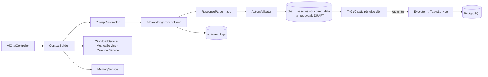
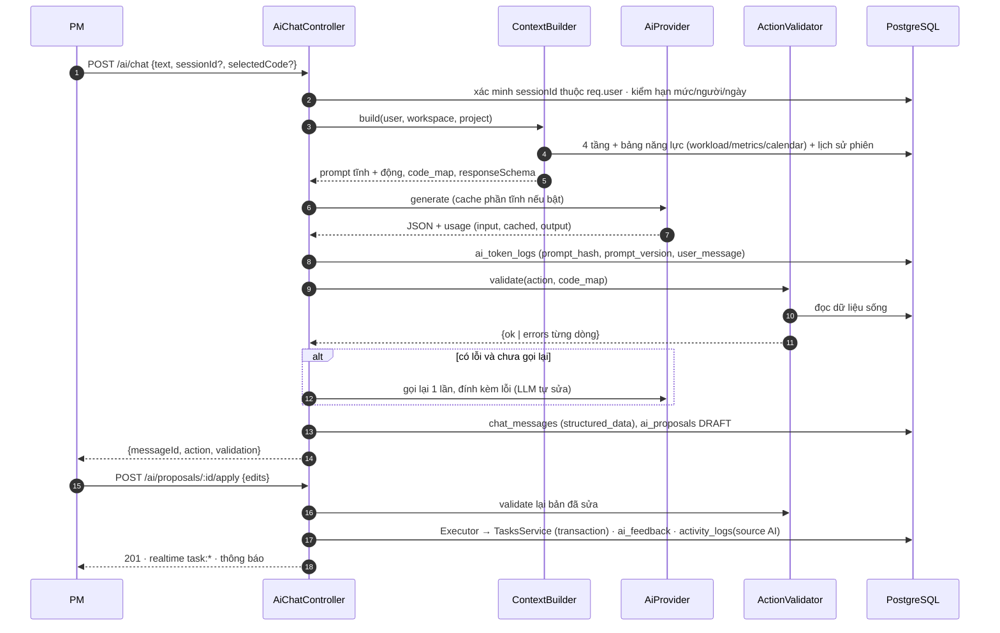

# 05 · AI Agent — LLM suy luận, backend chỉ tính

Kế thừa trực tiếp `~/Table_Calendar/docs/ai-scheduling-architecture/` (01 target architecture, 02 context model, 04 prompt architecture, 05 structured actions, 06 call flow) và mã `apps/api/src/ai-v2/` (context-builder, prompt-assembler, provider, action-validator, executor), `smart-scheduler/` (bảng ngữ cảnh, giờ trống, khớp tên, tách prompt tĩnh/động).

## 1. Ranh giới

| | LLM | Backend |
|---|---|---|
| Hiểu yêu cầu, phân rã, ước lượng thô, chọn người/giờ, giải thích, hỏi lại | ✔ | ✘ (không NLU/regex, không ranker, không optimizer) |
| Tính chỉ số (tải, năng lực, giờ trống, EAR, ETA…), lập bảng sự thật | ✘ | ✔ ([04](04-cong-thuc-tinh-toan.md)) |
| Kiểm tra đề xuất trên dữ liệu sống, trả lỗi kèm số | ✘ | ✔ (Validator) |
| Ghi dữ liệu | ✘ (chỉ đề xuất) | ✔ (Executor, sau khi người xác nhận, qua đúng service của UI) |
| Xếp hạng lại / thay người / thay giờ trong đề xuất | — | ✘ **cấm** |

Vì sao khác bản phác thảo D05 ban đầu: bản đó có `AssignmentPlanner` chấm điểm phù hợp và xếp lịch tham lam rồi đưa top-3 cho LLM — đó là "backend recommendation ranker" mà Table_Calendar V2 bác bỏ. Bản này bỏ hẳn: backend đưa **bảng sự thật đầy đủ** (mọi người × mọi task), LLM tự cân nhắc.

## 2. Thành phần



| Thành phần | Nhiệm vụ | Tham chiếu Table_Calendar |
|---|---|---|
| `ContextBuilder` | Nạp **mới từ DB mỗi lượt** 4 tầng ngữ cảnh; gán mã ngắn; không cache trong tiến trình | `ai-v2/context-builder.service.ts`, `13-db-context-loading.md` |
| `PromptAssembler` | Ghép các khối có tiêu đề; phần tĩnh trước, mốc `════════ DỮ LIỆU HAY THAY ĐỔI`, phần động sau | `ai-v2/prompt-assembler.ts`, `smart-scheduler/tach-prompt.ts` |
| `AiProvider` | Gọi Gemini (`responseSchema`) hoặc Ollama (JSON mode); retry 2 lần lỗi mạng/5xx; timeout 30 s; cache phần tĩnh (prompt) nếu bật; ghi sổ token | `ai-v2/provider.service.ts`, `ai-config/gemini-prompt-cache.service.ts` |
| `ResponseParser` | JSON → zod `structuredActionSchema` (discriminated union theo `type`); lỗi → coi như `CHAT_RESPONSE` kèm cờ `parseFailed` và ghi `raw_response` | `smart-scheduler/learned-knowledge.parser.ts` (thuần, không ném lỗi) |
| `ActionValidator` | Kiểm từng dòng trên dữ liệu sống; trả `{ok, errors[]}`; **không sửa** | `ai-v2/action-validator.service.ts` |
| `Executor` | Gọi `TasksService`/`SprintsService`/`MemoryService` — cùng đường code với UI | `ai-v2/executor.service.ts` |
| `ProposalStore` | `ai_proposals` DRAFT → APPLIED/REJECTED/EXPIRED (7 ngày); `ai_feedback` | mới |

## 3. Ngữ cảnh bốn tầng — áp cho SmartTask

| Tầng | Nội dung | Nguồn | Ghi đè được bởi |
|---|---|---|---|
| **1. Chính sách** | Master prompt (hệ thống) > Workspace prompt (Admin): giờ làm, sprint, ngưỡng tải, quy tắc "không giao quá 100%", giọng điệu | `ai_prompt_configs` | Không gì |
| **2. Sự thật** | DB > chỉ số backend tính > memory đã xác nhận > lời kể trong chat: danh bạ + kỹ năng, task mở, sprint, **bảng năng lực theo ngày**, chỉ số lịch sử, khoảng bận, snapshot burn-down | Prisma + `workload`/`metrics`/`calendar`/`forecast` | Không gì trong tầng 3–4 |
| **3. Ý định** | Yêu cầu hiện tại > prompt cá nhân > thói quen suy ra | request, `ai_personal_prompts`, `ai_habits` | Tầng 1, 2 |
| **4. Danh tính** | Danh bạ thành viên (mã ngắn, tên, vai, chức danh), alias kỹ năng, nhóm | `users`, `skill_aliases`, `project_members` | Không đoán; mơ hồ → `ASK_CLARIFICATION` |

Khối trong prompt (thứ tự cố định — quan trọng cho cache):

```
[TĨNH — dùng chung cả workspace]
 1. MASTER PROMPT (phiên bản v)            2. WORKSPACE PROMPT (v)
 3. DANH BẠ THÀNH VIÊN  (u1 Lan · PM · React 4, NestJS 2 · 40h/tuần)   4. DANH MỤC KỸ NĂNG + ALIAS
 5. DỰ ÁN & SPRINT (p1 SmartTask · sprint s3 13/10–24/10)
════════ DỮ LIỆU HAY THAY ĐỔI
[ĐỘNG — theo người dùng và thời điểm]
 6. TASK MỞ (t12 "Đăng nhập Google" · 8h · React 3 · hạn 20/10 · chưa giao · phụ thuộc t10)
 7. BẢNG NĂNG LỰC THEO NGÀY (mục 5 của 04) + CHỈ SỐ LỊCH SỬ (EAR n=6, đúng hạn, U tuần này)
 8. KHỚP KỸ NĂNG từng cặp (u × t chưa giao)
 9. ĐIỀU AI ĐÃ BIẾT (memory đã xác nhận)   10. THÓI QUEN (độ tin cậy)   11. SỞ THÍCH CÁ NHÂN (personal prompt)
12. LỊCH SỬ PHIÊN (20 tin gần nhất, kèm structured_data của lượt trợ lý)
13. YÊU CẦU HIỆN TẠI của u1 Lan
```

### 3.1 Mã ngắn thay UUID

Table_Calendar đo được 205 UUID chiếm 12,4% prompt cho một trường không ai đọc (`smart-scheduler.service.ts`, ghi chú ở `writeTokenLog`). SmartTask dùng **mã ngắn theo lượt**: `u1…uN` cho người, `t1…tM` cho task, `s1` cho sprint, `k1…` cho kỹ năng. `ContextBuilder` sinh bảng ánh xạ, lưu trong `ai_proposals.code_map`; LLM chỉ trả mã ngắn; Validator đổi về UUID, **mã lạ = lỗi `UNKNOWN_CODE`** (không đoán). Lợi ích kép: rẻ hơn và không thể bịa UUID.

### 3.2 Dạng bảng, không JSON, cho dữ liệu vào

Theo `smart-scheduler/bang-du-lieu.ts`: dữ liệu vào viết dạng bảng văn bản `cột | cột` — ít token hơn JSON ~35% và LLM đọc tốt hơn. Sắp hàng theo mã ổn định (không theo thời điểm gặp) để phần văn bản không đổi khi dữ liệu không đổi (lý do: cache khớp theo tiền tố — xem [07](07-cache-va-chi-phi.md)).

## 4. Đầu ra có cấu trúc — Structured Actions

Discriminated union theo `type`; luôn có `reply` (văn bản hiển thị) và `schemaVersion`. Định nghĩa zod trong `packages/shared/schemas/structured-action.ts`; với Gemini dùng `responseSchema` sinh từ zod (`zod-to-json-schema`), với Ollama dùng `format: json` + validate.

| type | Khi nào | Trường chính |
|---|---|---|
| `DECOMPOSE_PROPOSAL` | Yêu cầu lớn → task | `tasks[]: {draftKey, title, description, estimateHours, priority, difficulty, requiredSkills[k], subtasks[], dependsOn[draftKey], suggestedAssignee?: u, reason}`, `assumptions[]`, `sprint: s` |
| `CREATE_TASK_DRAFT` | "Tạo task X cho Lan hạn thứ 6" | `drafts[]` cùng shape với task ở trên + `assignee: u`, `start`, `due` |
| `UPDATE_TASK_DRAFT` | "Sửa cái thứ hai thành 6 giờ", dời hạn | `targetTask?: t`, `targetDraftKey?`, `patch`, `resolutionReason` |
| `ASSIGN_PROPOSAL` | Giao / giao lại | `assignments[]: {task: t \| draftKey, assignee: u, start, due, reason, alternatives[]: {assignee: u, tradeoff}}`, `unassigned[]: {task, why}`, `fairnessEstimate`, `warnings[]` |
| `REBALANCE_PROPOSAL` | "Ai quá tải, gỡ bớt" | `moves[]: {task: t, from: u, to: u, reason}` |
| `RISK_EXPLANATION` | "Vì sao sprint chậm, nên làm gì" ("có kịp không" → `DATA_QUERY SPRINT_PROGRESS`, từ 28/09) | `riskLevel` (phải trùng số backend — kiểm ở **cả** nhánh EXPLAIN **và** chat), `causes[]`, `recommendations[]` |
| `MEMORY_PROPOSAL` | Người nói điều nên nhớ lâu dài | `memory: {kind, content}` — chờ xác nhận ([06](06-tri-nho-ai.md)) |
| `ASK_CLARIFICATION` | Mơ hồ: hai "Minh", không rõ sprint, thiếu hạn | `question`, `options[]: {code, label}` |
| `CHAT_RESPONSE` | Trả lời câu hỏi từ ngữ cảnh, từ chối theo chính sách | `reply`, `dataRef?` (ví dụ `workload:week:u1` để UI vẽ thẻ số từ backend) |

Không có action cho alias/thói quen (Admin quản alias; thói quen do hệ thống suy) — đúng quy tắc 5–6 của Master prompt bên Table_Calendar.

## 5. Nhận dữ liệu từ LLM và hiển thị JSON (không phải văn bản thô)

1. `AiProvider` trả chuỗi → `ResponseParser` parse + zod. Thành công: lưu `chat_messages(role=ASSISTANT, text=reply, structured_data=action, schema_version)`. Thất bại: lưu `text = chuỗi thô đã cắt`, `structured_data = {type: "CHAT_RESPONSE", parseFailed: true}`, `ai_token_logs.raw_response`.
2. API trả cho web `{ sessionId, messageId, action }` — **không bao giờ** trả JSON chưa validate.
3. Web render theo `action.type` (theo `~/Table_Calendar/apps/web/src/components/AIChatPanel.tsx`): nhãn trạng thái ("BẢN XEM TRƯỚC — CẦN XÁC NHẬN", "CẦN LÀM RÕ", "AI ĐỀ XUẤT GHI NHỚ"), `reply` dạng văn bản, rồi **thẻ dữ liệu**:
   - `DECOMPOSE_PROPOSAL` / `CREATE_TASK_DRAFT`: bảng chỉnh tại chỗ (giờ, ưu tiên, người, hạn), tổng giờ so với năng lực còn lại sprint (số backend tính), nút "Tạo N công việc".
   - `ASSIGN_PROPOSAL`: bảng task → người → khung ngày → lý do; cột "kiểm tra" từ Validator (✓ / lỗi kèm số); biểu đồ tải trước/sau (backend tính); nút "Áp dụng" chỉ bật khi mọi dòng ✓ hoặc PM đã sửa.
   - `ASK_CLARIFICATION`: chip lựa chọn; bấm chip = gửi lượt mới có `selectedCode`.
   - `MEMORY_PROPOSAL`: thẻ "Ghi nhớ?" với nút xác nhận/bỏ.
   - `RISK_EXPLANATION`: Alert theo mức, nhưng **mức và số liệu lấy từ backend**, AI chỉ cấp phần văn bản.
4. Lượt sau, LLM thấy lại `structured_data` của lượt trước trong LỊCH SỬ PHIÊN → hiểu "phương án 2", "cái thứ hai" (`06-ai-call-flow.md`, kịch bản C).

## 6. Đoán "ai" — mention và định danh

- **@mention trong bình luận** (UC-18): giao diện Combobox gọi `GET /projects/:id/members/suggest?q=` — tìm kiểu elastic (Elasticsearch khi có, `pg_trgm + unaccent` khi không): không dấu, gõ thiếu, sai một ký tự, email; người dùng chọn tường minh, không AI.
- **Tên người trong chat**: LLM nhận DANH BẠ (mã ngắn, họ tên, tên gọi ngắn, chức danh, vai) và tự đối chiếu. Một khớp → dùng; nhiều khớp ("Bảo" → Thế Bảo, Gia Bảo) → `ASK_CLARIFICATION` với `options` là mã ngắn. Backend **không** chọn hộ (bài học `smart-scheduler/person-name-match.ts`: `includes()` lấy người đầu tiên đã mời nhầm người).
- **Validator** vẫn đối chiếu lại mã ngắn với danh bạ và quyền; mã không có → lỗi, không "khớp mờ hộ".
- **Kỹ năng do LLM sinh** ("ReactJS", "react js"): ánh xạ về danh mục bằng `skill_aliases` rồi khớp mờ theo tiếng có bỏ dấu (hàm `boDau`, `chuaCumTu` — sao chép từ `person-name-match.ts`); khớp mờ ở đây là **chuẩn hoá dữ liệu vào danh mục**, không phải quyết định nghiệp vụ; không khớp → bỏ và ghi `assumptions`.
- **Tìm kiếm tên trong DB**: Postgres `contains` phân biệt dấu → luôn lọc lại ở tầng ứng dụng bằng `boDau` (ghi chú trong `person-name-match.ts`); `pg_trgm` đã bật trong `infra/init/01-extensions.sql`.

## 7. Tạo task từ chat và chỉnh sửa nhiều lượt

Mô hình "bản nháp có khoá" của Table_Calendar (`MeetingDraft.draftKey`) áp cho task:

1. Lượt 1: "Tạo 3 task cho màn đăng nhập, giao Huy, hạn thứ Sáu" → `CREATE_TASK_DRAFT` với `drafts[d1..d3]`; Validator kiểm người/hạn/giờ trống; thẻ xem trước.
2. Lượt 2: "cái thứ hai đổi thành 6 giờ, giao Lan" → LLM đọc `structured_data` lượt 1, trả `UPDATE_TASK_DRAFT {targetDraftKey: d2, patch}`; backend gộp patch vào bản nháp (thuần), Validator kiểm lại dòng d2.
3. Bấm "Tạo" trên thẻ (hoặc nói "đồng ý" — vẫn là một lượt LLM, backend không regex "ok/đồng ý") → Executor tạo trong một giao dịch.
4. Bản nháp sống theo phiên, hết hạn 7 ngày; mở lại phiên thấy lại thẻ với trạng thái.

## 7b. Người dùng chat được gì — bảng ánh xạ câu nói → hành động

Mọi dòng dưới đây đều: LLM trả structured action → Validator kiểm trên dữ liệu sống → thẻ xem trước → **người bấm xác nhận** → Executor gọi đúng service của UI → sự kiện realtime, thông báo, tính lại tải chạy như thao tác tay. Không có lệnh chat nào ghi thẳng.

| Người nói (ví dụ) | Action | Validator kiểm | Sau khi xác nhận |
|---|---|---|---|
| "Tạo 3 task cho màn đăng nhập, giao Huy, hạn thứ Sáu" | `CREATE_TASK_DRAFT` (d1–d3) | người là thành viên, giờ trống trước hạn, kỹ năng | `TasksService.createMany` |
| "Dời hạn ST-12 sang 24/10", "cái thứ hai đổi thành 6 giờ", "chuyển ST-12 sang sprint 4", "đổi người làm ST-7 thành Lan" | `UPDATE_TASK_DRAFT` (patch: dueDate / estimateHours / sprintId / assignees) | version hiện tại, hạn ≥ start, sprint tồn tại, `FreeBefore` của người mới | `TasksService.update/assign` (kèm `version`) |
| "Phân rã yêu cầu: xây dựng quên mật khẩu qua email" | `DECOMPOSE_PROPOSAL` | 1–25 task, ước lượng 0,5–40 h, kỹ năng trong danh mục, không vòng | tạo hàng loạt |
| "Giao hết việc sprint 3, đừng dồn cho Lan" | `ASSIGN_PROPOSAL` | từng dòng: thành viên, nghỉ, kỹ năng, giờ trống, ≤ 110% | `assign/reschedule` từng task, ghi `ai_feedback` |
| "Ai đang quá tải? Gỡ bớt cho Minh" | `REBALANCE_PROPOSAL` (moves[]) | như trên cho người nhận | `assign` từng task |
| "Sprint này có kịp không?" | `DATA_QUERY` `SPRINT_PROGRESS` (ETA, vận tốc, mức rủi ro do backend tính) | reply không chứa số | không ghi gì |
| "Vì sao chậm, nên làm gì?" | `RISK_EXPLANATION` — ngữ cảnh CHAT có mục MỨC RỦI RO SPRINT (backend) | `riskLevel` phải trùng số backend; lệch → gọi lại kèm lỗi, vẫn lệch thì thẻ ghi "chưa khớp số hệ thống" (validation lưu cùng tin) | không ghi gì |
| "Tuần này tôi còn bao nhiêu giờ trống?", "Lan đang bao nhiêu %?" | `CHAT_RESPONSE` (đọc từ BẢNG NĂNG LỰC trong ngữ cảnh) + `dataRef` tuỳ chọn để UI vẽ thẻ số | — | không ghi gì |
| "Từ giờ đừng giao Minh tuần cuối tháng" | `MEMORY_PROPOSAL` (+ đề xuất ghi vào `user_time_off`) | — | memory hoặc dữ liệu có cấu trúc, theo nút người chọn |
| "Giao cho Bảo" (có hai Bảo) | `ASK_CLARIFICATION` (options u4, u9) | — | lượt sau mang `selectedCode` |
| "Tính lại tải đi" | không cần action riêng: mỗi lượt ContextBuilder **nạp mới** chỉ số từ DB, và mọi thay đổi đã áp dụng đều phát `task.updated` → `WorkloadListener` tính lại ngay | — | UI có thêm nút "Tính lại" gọi `POST /projects/:id/workload/recompute` |

Giới hạn cố ý: chat **không** đổi cấu hình workspace, vai trò, prompt, alias (Admin làm trên màn cấu hình); không xoá dự án/sprint; không tạo/đổi thói quen. Mức triển khai: MVP có `POST /projects/:id/ai/decompose` (form) và `forecast/explain`; chat theo phiên là mục S9 trong [11](11-chot-chuc-nang-va-api.md), làm sau khi có bảng năng lực (S4).

## 7c. Vòng đời và dung lượng `ai_proposals` — để không phình

Đề xuất chỉ sinh ra khi **người chủ động** (bấm "Phân rã", "Đề xuất phân công", hoặc gửi một tin nhắn); AI không có cron, không có vòng lặp tự gọi. Vì vậy số dòng bị chặn trên bởi hạn mức gọi AI (mặc định 20 lượt/người/ngày). Thêm bốn quy tắc:

| Quy tắc | Cơ chế |
|---|---|
| **Một bản nháp mỗi (dự án, người, loại)** | Tạo đề xuất mới cùng loại → bản DRAFT cũ chuyển `EXPIRED` ngay; DB khoá bằng partial unique index `ai_proposals_one_draft (project_id, user_id, kind) WHERE status = 'DRAFT'` |
| **Sửa nhiều lượt = cập nhật một dòng** | "cái thứ hai đổi 6 giờ" → `UPDATE_TASK_DRAFT` vá vào `payload` của đề xuất đang mở, không tạo dòng mới |
| **Bấm trùng không tạo hai lượt** | Nút khoá khi đang gọi; server giữ khoá trong bộ nhớ theo (dự án, người, loại) — lượt thứ hai khi lượt đầu chưa xong → 409; DRAFT đang mở được trả lại thay vì gọi mới |
| **Dọn theo tuổi** (cron 03:00) | DRAFT quá `expires_at` (7 ngày) → EXPIRED; EXPIRED/REJECTED quá 30 ngày → xoá; APPLIED giữ 180 ngày rồi xoá (`tasks.ai_proposal_id` về null, nguồn AI vẫn còn ở `activity_logs.source` và `tasks.source`) |

Ước lượng xấu nhất: 5 người × 20 lượt/ngày × 60 ngày = 6.000 dòng, mỗi `payload` 5–20 KB → dưới 100 MB, trước cả khi cron dọn; thực tế ít hơn nhiều vì phần lớn lượt là hỏi đáp (`CHAT_RESPONSE`, `ASK_CLARIFICATION`) không tạo đề xuất.

## 8. Giờ trống trong prompt

Lấy từ [04 mục 5](04-cong-thuc-tinh-toan.md#5-giờ-trống-theo-ngày-đầu-vào-chính-cho-llm-giao-việc): mỗi người một dòng khoảng bận + giờ trống theo ngày + khối tập trung. LLM đề xuất `start`/`due`; Validator kiểm `FreeBefore`. Chính sách trong Master prompt: task độ khó ≥ 4 chỉ đặt vào ngày có khối tập trung; không đặt việc vào ngày nghỉ.

## 9. Luồng gọi một lượt



## 10. Cấu hình theo mục đích

`ai_configs.purpose ∈ {DECOMPOSE, ASSIGN, EXPLAIN, CHAT}` (theo `AiConfig.purpose` của Table_Calendar — "một model chỉnh cho việc này là hỏng việc kia"): phân rã cần sáng tạo hơn (temperature 0,5), phân công cần bám schema và số liệu (0,2), giải thích rẻ (flash-lite). Chưa khai mục đích riêng → dùng cấu hình mặc định. Năng lực model (`supports_structured_output`, `supports_temperature`, `is_reasoning`, `cache_mode`) khai trong `ai_model_catalog` **chỉ cho model đã thử thật** — không đoán theo tên (bài học "gemini" chứa "mini").

## 11. Master prompt (bản nháp)

```
Bạn là trợ lý quản trị dự án của SmartTask. Từ vựng: Workspace, Project, Sprint (start, end),
Task (mã t, tiêu đề, giờ ước lượng, giờ còn lại, độ khó 1–5, kỹ năng yêu cầu, hạn, người thực hiện,
phụ thuộc), Member (mã u, kỹ năng mức 1–5, năng lực giờ/tuần, mức sử dụng U, giờ trống theo ngày).

BỐN NHÓM THẨM QUYỀN: 1 Chính sách (Master > Workspace) — không gì mâu thuẫn được; 2 Sự thật
(dữ liệu và chỉ số hệ thống tính > điều AI đã biết > lời kể trong chat) — KHÔNG BAO GIỜ bị ghi đè;
3 Ý định (yêu cầu hiện tại > sở thích cá nhân > thói quen) — chỉ khi không vi phạm 1 và 2;
4 Danh tính (danh bạ, alias kỹ năng) — không chắc thì hỏi lại.

QUY TẮC TUYỆT ĐỐI:
1. Mọi con số về tải, năng lực, giờ trống, EAR, ETA trong ngữ cảnh là SỰ THẬT do hệ thống tính.
   Bạn không tự tính lại; bạn cân nhắc và chọn.
2. Không giao thêm cho người có U sau khi nhận > 1.00 trừ khi yêu cầu hiện tại nói rõ chấp nhận.
3. Không đặt việc vào ngày nghỉ; task độ khó ≥ 4 chỉ vào ngày có khối tập trung.
4. Chỉ dùng mã u/t/s/k có trong ngữ cảnh. Không bịa người, task, kỹ năng. Mơ hồ → ASK_CLARIFICATION.
5. Bạn chỉ ĐỀ XUẤT structured action đúng schema; backend là nơi duy nhất ghi dữ liệu sau khi người xác nhận.
6. Không đề xuất hành động về alias hay thói quen.
7. Trả lời tiếng Việt, ngắn, nêu lý do và đánh đổi; không tiết lộ rating/điểm burnout của người khác,
   chỉ nói "đang khá đầy" hoặc "còn trống ~8 giờ".
```

## 12. Đánh giá và hồi quy prompt

Theo `smart-scheduler/regression/run.ts`: bộ 20 kịch bản (`docs/04-kien-truc/regression/*.json`: yêu cầu + ngữ cảnh đóng băng + `type` mong đợi + ràng buộc phải đúng) chạy bằng script tuần một lần và trước khi đổi Master/Workspace prompt; kết quả ghi vào báo cáo Chương 3 (tỷ lệ đúng type, tỷ lệ qua Validator lần đầu, token trung bình, thời gian). `ai_token_logs.prompt_version` cho phép so hai phiên bản prompt trên cùng số liệu.
