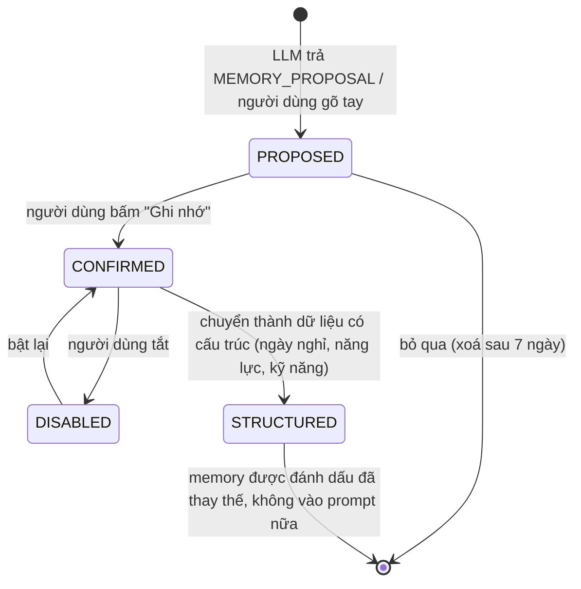

# 06 · Trí nhớ của trợ lý AI

Ba thứ dễ lẫn nhưng **khác chủ sở hữu và khác vòng đời** (theo `~/Table_Calendar/docs/ai-scheduling-architecture/07-memory-alias-habit.md`): tri thức chung do Admin quản (alias, nhóm, chính sách), **trí nhớ** do người dùng xác nhận, **thói quen** do hệ thống suy ra. Không gộp vào một bảng `{userId, type, content}` — quyền ghi và độ tin cậy khác nhau phải được thể hiện bằng bảng và route riêng.

## 1. Ba loại và chủ sở hữu

| | Chủ sở hữu | Ai tạo/sửa | Độ tin cậy | Vào prompt ở tầng |
|---|---|---|---|---|
| **Tri thức workspace** (Workspace prompt, alias kỹ năng, nhóm) | Admin | Admin qua màn cấu hình; LLM không có action nào cho việc này | Chính sách / danh tính | 1 và 4 |
| **Trí nhớ** (`ai_memories`) | Người dùng (người mà trợ lý phục vụ) | Người dùng tự ghi, hoặc LLM đề xuất (`MEMORY_PROPOSAL`) và **người dùng xác nhận** | Sự thật đã xác nhận, không có điểm tin cậy | 2 (dưới DB và chỉ số) |
| **Thói quen** (`ai_habits`) | Hệ thống suy ra cho từng người dùng; người dùng bật/tắt/xoá/nâng cấp | Không ai sửa nội dung; hệ thống cập nhật `times_observed`, `confidence` | Xác suất | 3 (thấp nhất) |

Trí nhớ và thói quen là **riêng tư theo `user_id`**: ghi chú của PM về thành viên ("Huy giỏi React nhưng hay trễ") chỉ dùng trong phiên của PM đó, không hiện cho Huy, không hiện cho PM khác. Thứ cần dùng chung thì Admin đưa vào Workspace prompt hoặc thành dữ liệu có cấu trúc (mức kỹ năng do PM xác nhận trong `user_skills`).

## 2. Các loại trí nhớ của SmartTask

| `kind` | Ví dụ | Ghi chú xử lý |
|---|---|---|
| `PERSONAL` — sự thật về thế giới của người dùng | "Tôi phụ trách module thanh toán", "Tôi làm việc từ xa thứ Tư" | Dùng để giải thích, gợi ý; không ràng buộc |
| `SCHEDULE` — ràng buộc/sở thích thời gian (sắp xếp lịch) | "Không nhận việc mới ngày thứ Sáu", "Buổi sáng làm việc khó, chiều họp", "Tuần 20–24/10 nghỉ phép" | Nếu diễn tả được bằng dữ liệu có cấu trúc (ngày nghỉ, giờ làm) → thẻ đề xuất kèm nút **"Ghi vào ngày nghỉ / giờ làm"** để thành sự thật DB; DB luôn thắng memory |
| `ASSIGNMENT` — sở thích sắp xếp việc | "Ưu tiên giao việc React cho Huy", "Minh muốn học NestJS: mỗi sprint một việc nhỏ", "Việc UI đừng giao cho tôi" | LLM cân nhắc ở tầng ý định; Validator vẫn kiểm năng lực/kỹ năng như thường |
| `CAPACITY` — ghi chú năng lực cá nhân | "Từ tháng 11 tôi làm bán thời gian 24 h/tuần", "Ước lượng của tôi thường thiếu 30% với việc backend", "Đang học Docker, chưa tự tin" | `24 h/tuần` → đề xuất ghi vào `users.weekly_capacity_hours`; phần định tính giữ làm memory; EAR thật vẫn do `metrics` đo |
| `PROJECT` — bối cảnh dự án theo góc nhìn người dùng | "Dự án SmartTask ưu tiên demo AI trước Gantt" | Chỉ trong phiên của người đó |

Quy tắc chuyển đổi: trí nhớ nào có **dạng cấu trúc tương đương** (ngày nghỉ, năng lực giờ/tuần, mức kỹ năng, hạn task) thì trợ lý đề xuất ghi vào bảng có cấu trúc thay vì giữ dạng văn xuôi — vì tầng "sự thật DB" được Validator dùng, còn memory chỉ được LLM đọc.

## 3. Thói quen suy ra (`ai_habits`)

| `type` | Suy từ | Ví dụ mô tả sinh ra | Dùng để |
|---|---|---|---|
| `ASSIGN_PATTERN` | `ai_feedback`: PM đổi đề xuất "giao cho X" sang "Y" ≥ 3 lần | "Bạn thường chuyển việc NestJS từ u3 sang u5 (đã thấy 4 lần)" | LLM cân nhắc; nếu người dùng xác nhận → nâng thành memory `ASSIGNMENT` |
| `TIME_PATTERN` | Hạn task người dùng đặt; giờ hoàn thành | "Bạn thường đặt hạn vào thứ Sáu", "Bạn thường hoàn thành việc trước 11h" | Gợi ý hạn/khung giờ |
| `ESTIMATE_PATTERN` | EAR theo nhóm kỹ năng (định lượng ở `metrics`) | "Ước lượng việc frontend của bạn thường thiếu ~30% (n=8)" | Giải thích; số thật vẫn nằm ở EAR |
| `SKILL_GROWTH` | Task ngoài kỹ năng khai báo hoàn thành đúng hạn, rating ≥ 4, ≥ 3 lần | "Bạn đã làm tốt 3 việc NestJS dù khai mức 2" | Đề xuất PM nâng mức trong `user_skills` (qua UC-22, không tự nâng) |
| `SCOPE_PATTERN` | Task XL thường bị chia nhỏ sau khi bắt đầu | "Việc > 16 giờ của bạn thường bị chia lại" | Nhắc phân rã trước |

`confidence` = hàm của `times_observed` và độ mới (giảm dần sau 8 tuần không tái quan sát); ngưỡng đưa vào prompt mặc định `0.6`. Người dùng thấy toàn bộ thói quen của mình ở màn "Thói quen đã học", tắt được từng dòng (`is_visible = false` → không vào prompt, vẫn tiếp tục đếm để có thể bật lại).

## 4. Vòng đời trí nhớ



- LLM chỉ được **đề xuất** (`MEMORY_PROPOSAL {kind, content, suggestedStructured?}`); backend lưu PROPOSED và hiển thị thẻ; không có memory nào vào prompt khi chưa CONFIRMED.
- Mỗi memory giữ `source_message_id` (nguồn gốc) để người dùng xem lại "tại sao AI nghĩ vậy".
- Memory có thời hạn (`valid_until`, ví dụ nghỉ phép) tự hết hiệu lực; cron dọn.
- Giới hạn 50 memory đang hiệu lực/người vào prompt (cũ nhất bị lược, hiển thị cảnh báo) — kiểm soát token.

## 5. Vào prompt như thế nào

Các khối (theo `04-prompt-architecture.md` của Table_Calendar), mỗi khối nói rõ mình **không** ghi đè được gì:

```
--- ĐIỀU AI ĐÃ BIẾT về u1 Lan (sự thật đã xác nhận — dùng để giải thích và cân nhắc,
KHÔNG BAO GIỜ dùng để bỏ qua dữ liệu, chỉ số hay giờ trống hệ thống tính ở trên) ---
- [SCHEDULE] Không nhận việc mới ngày thứ Sáu (xác nhận 03/10)
- [ASSIGNMENT] Ưu tiên giao việc React cho u4 Huy (xác nhận 05/10)
- [CAPACITY] Đang học Docker, chưa tự tin (xác nhận 06/10)
--- HẾT ĐIỀU AI ĐÃ BIẾT ---

--- THÓI QUEN suy luận được (độ tin cậy thấp — bị ghi đè bởi sở thích cá nhân và yêu cầu hiện tại;
BỎ QUA nếu mâu thuẫn với dữ liệu thật hoặc chính sách) ---
- Bạn thường chuyển việc NestJS từ u3 sang u5 (đã thấy 4 lần, tin cậy 0.7)
--- HẾT THÓI QUEN ---

--- SỞ THÍCH CÁ NHÂN của u1 Lan (do chính người dùng viết — không ghi đè chính sách/sự thật;
bị ghi đè bởi yêu cầu hiện tại nếu mâu thuẫn trực tiếp) ---
Mỗi sprint giao ít nhất một việc ngoài sở trường cho người mới.
--- HẾT SỞ THÍCH CÁ NHÂN ---
```

Thứ tự thẩm quyền khi mâu thuẫn: dữ liệu và chỉ số (giờ trống, U, ngày nghỉ) > memory đã xác nhận > lời kể trong chat; yêu cầu hiện tại > sở thích cá nhân > thói quen; tất cả dưới chính sách. Validator kiểm trên dữ liệu thật bất kể memory nói gì (memory "Lan thường rảnh sáng" không qua được `FreeBefore` nếu lịch họp sáng đó có thật).

## 6. Trí nhớ về sắp xếp lịch và sắp xếp việc — ví dụ luồng

1. PM: "Từ giờ đừng giao việc gì cho Minh vào tuần cuối tháng, cậu ấy làm báo cáo tài chính."
2. LLM: `CHAT_RESPONSE` + `MEMORY_PROPOSAL {kind: SCHEDULE, content: "Không giao việc cho u3 Minh vào tuần cuối mỗi tháng", suggestedStructured: {type: RECURRING_TIME_OFF, user: u3, rule: "tuần cuối tháng", hoursPerDay: 8}}`.
3. Thẻ hiển thị hai nút: "Ghi nhớ" (memory, chỉ PM thấy) và "Ghi vào lịch bận của Minh" (tạo `user_time_off` lặp — sự thật DB, Validator dùng, Minh cũng thấy). PM chọn nút thứ hai vì muốn hệ thống chặn thật.
4. Lượt sau, bảng năng lực của Minh tuần cuối tháng có `Free = 0`; LLM không đề xuất; nếu PM cố tình ghi tay, Validator báo `ASSIGN_ON_LEAVE`.

## 7. API

| Phương thức | Đường dẫn | Ghi chú |
|---|---|---|
| GET / POST | `/me/ai/memories` | Danh sách, tạo tay (`kind`, `content`, `valid_until?`) |
| PATCH / DELETE | `/me/ai/memories/:id` | Xác nhận PROPOSED, tắt/bật, sửa nội dung, xoá |
| POST | `/me/ai/memories/:id/structure` | Chuyển thành dữ liệu có cấu trúc (body theo `suggestedStructured`) |
| GET | `/me/ai/habits` · PATCH `/me/ai/habits/:id` | Xem, tắt/bật, nâng thành memory |
| GET / PUT | `/me/ai/personal-prompt` | Sở thích cá nhân (văn bản, ≤ 2.000 ký tự) |

Tất cả chỉ theo `req.user`; Admin không có route đọc memory của người khác (chưa có yêu cầu kiểm toán — theo `12-data-ownership-and-crud.md`).
