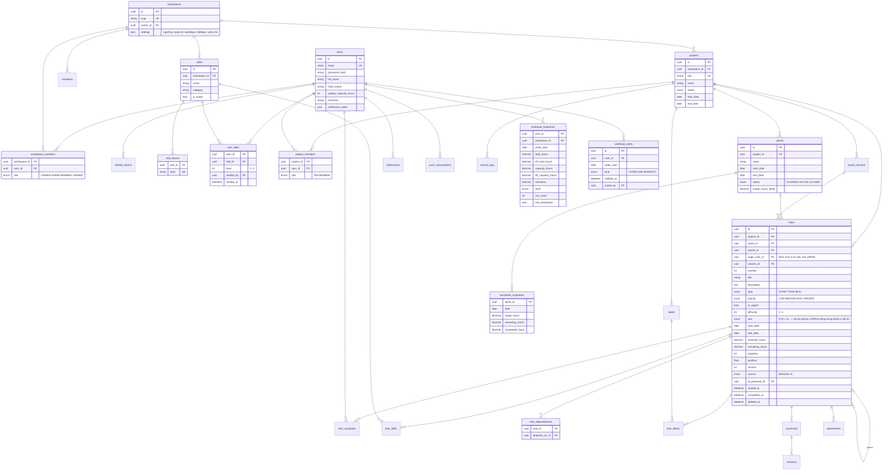

# 08 · Mô hình dữ liệu

ERD mức khái niệm; kiểu chi tiết viết trong `apps/api/prisma/schema.prisma` (Tuần 07). Chuẩn 3NF: mọi thuộc tính phụ thuộc đầy đủ vào khoá; bảng nối cho quan hệ N–N; giá trị tính (mức sử dụng, EAR) không lưu trong bảng gốc mà trong bảng snapshot/metrics có ngày.

## 1. Lõi nghiệp vụ (27 bảng)

Các bảng còn lại của lõi có thuộc tính hiển nhiên: `invitations(email, token, role, expires_at, status)`, `refresh_tokens(user_id, token_hash, expires_at, revoked_at)`, `board_columns(name, status_key, position, wip_limit)`, `labels(name, color)`, `task_assignees`, `task_skills(min_level)`, `task_labels`, `comments(body, parent_id, edited_at)`, `mentions`, `attachments(file_name, mime, size_bytes, storage_path)`, `notifications(type, title, link, is_read)`, `push_subscriptions(endpoint UK, p256dh, auth, user_agent)`, `activity_logs(project_id, task_id, actor_id, action, diff json, source)`.

## 2. AI, chat, lịch, lịch sử (15 bảng — `schema.prisma`, migration `ai_chat_calendar_metrics` + `ai_tables_review` + `drop_ai_response_cache`)

> Rà soát dư/đủ ngày 15/09: bỏ `ai_personal_prompts` (→ cột `users.ai_personal_prompt`), `ai_usage_daily` (đếm log), `weekly_checkins` (UC-41 không làm); bỏ `ai_configs.provider/model/giá` (tra catalog) và `ai_proposals.workspace_id`; thêm `ai_token_logs.proposal_id`; `ai_response_cache` từng thêm rồi bỏ (không cần ở quy mô này). Lý do từng điểm: [05-hien-thuc/ra-soat-bang-ai.md](../05-hien-thuc/ra-soat-bang-ai.md).

Đối chiếu với Table_Calendar (`AiConfig`, `AiModelCatalog`, `AiTokenLog`, `PromptConfiguration`, `ChatSession/ChatMessage`, `AiRuntimeConfig`) và ELPREP (`AiConfig.purpose`, `AiModelCatalog.supportsVision/maxOutputTokenParam`, `AiTokenLog.reasoningTokens/estimatedCost/status TIMEOUT|INVALID_OUTPUT`, `PromptConfiguration` có `changeNote` + unique `(type, version)`, `AiUsage` đếm hạn mức theo ngày):

| Bảng SmartTask | Lấy từ | Thêm/khác |
|---|---|---|
| `ai_model_catalog` | cả hai | + `cached_input_price`, `price_effective_from`, `context_window`, `cache_mode` (Table_Calendar), `supports_vision`, `max_output_token_param` (ELPREP) |
| `ai_configs` | cả hai | `workspace_id` null = mặc định hệ thống; `purpose` GENERAL/DECOMPOSE/ASSIGN/EXPLAIN/CHAT; khoá mã hoá AES-GCM; **chỉ** `catalog_id` (không lặp provider/model/giá — chi phí lịch sử nằm ở `ai_token_logs.estimated_cost`) |
| `ai_prompt_configs` | `PromptConfiguration` | MASTER (hệ thống) / WORKSPACE; partial unique: một ACTIVE mỗi (workspace, type), version không trùng |
| `users.ai_personal_prompt`, `ai_memories`, `ai_habits` | Table_Calendar V2 (Personal prompt, Memory, Habit) | prompt cá nhân là cột trên `users` (1:1, ≤ 2.000 ký tự); memory có `kind`, `status`, `suggested_structured`, `valid_until`; habit có `times_observed`, `confidence`, `is_visible` |
| `chat_sessions`, `chat_messages` | Table_Calendar | + `project_id`, `parse_failed`; `structured_data` là action đã validate |
| `ai_proposals`, `ai_feedback` | mới | vòng đời DRAFT→APPLIED, `code_map`, `validation_result`; workspace suy từ `project_id`; feedback = đề xuất vs quyết định + Spread trước/sau |
| `ai_token_logs` | cả hai | + `purpose`, `workspace_id`, `message_id`, `proposal_id`, `reasoning_tokens`, `estimated_cost`, `master/workspace_prompt_version`, status có `QUOTA`; hạn mức/ngày = `COUNT(*)` trên index `(user_id, created_at)` |
| `calendar_connections`, `calendar_events` | mới | chỉ khung giờ bận |
| `time_entries`, `task_reviews`, `user_metrics_weekly` | mới | nguồn EAR, rating, vận tốc; check-in tuần (UC-41) không làm nên không có bảng |
| `user_time_off` | (đã ở lõi) | |
| `member_aliases` (Phase 8) | Table_Calendar `UserAlias` | `workspace_id, user_id, alias citext`, unique `(workspace_id, alias)` — admin quản, chỉ để LLM nhận diện ([12 §2](12-chat-phien-va-ban-nhap.md)) |
| `workspace_members` + `department`, `title`, `manager_user_id` (Phase 8) | mới | dữ liệu DANH TÍNH cho prompt; chính sách chọn người ở `ai_prompt_configs` WORKSPACE |
| `chat_sessions` + `next_draft_seq`, `last_turn_at`, `archived_at`; `ai_proposals` + `session_id`, `version`, `item_status`, `applied_map`, kind `TASK_UPDATE` (Phase 8) | mới | bản nháp sửa nhiều lượt sống ở server; partial unique `ai_proposals_one_draft` chỉ còn áp cho `session_id IS NULL` |

Không lấy `AiRuntimeConfig` (singleton) của Table_Calendar: các tuỳ chọn `dataSources`/`promptCache` đặt trong `ai_configs.advanced_params` theo từng cấu hình, vì SmartTask đa workspace.

```mermaid
erDiagram
  workspaces ||--o{ ai_configs : ""
  ai_model_catalog ||--o{ ai_configs : ""
  workspaces ||--o{ ai_prompt_configs : ""
  users ||--o| ai_personal_prompts : ""
  users ||--o{ ai_memories : ""
  users ||--o{ ai_habits : ""
  users ||--o{ chat_sessions : ""
  chat_sessions ||--o{ chat_messages : ""
  chat_messages o|--o{ ai_proposals : ""
  ai_proposals ||--o{ ai_feedback : ""
  ai_configs ||--o{ ai_token_logs : ""
  users ||--o{ calendar_connections : ""
  calendar_connections ||--o{ calendar_events : ""
  users ||--o{ user_time_off : ""
  tasks ||--o{ time_entries : ""
  tasks ||--o| task_reviews : ""
  users ||--o{ user_metrics_weekly : ""
  users ||--o{ weekly_checkins : ""
  ai_model_catalog { uuid id PK
                     string provider
                     string model
                     string label
                     float input_price
                     float output_price
                     float cached_input_price
                     int context_window
                     bool supports_structured_output
                     bool supports_temperature
                     bool is_reasoning
                     string cache_mode "NONE GEMINI_CACHED_CONTENTS OPENAI_BREAKPOINT"
                     date price_effective_from }
  ai_configs { uuid id PK
               uuid workspace_id FK "null = mặc định hệ thống"
               string provider
               string model
               string api_key_encrypted
               string base_url
               enum purpose "DECOMPOSE ASSIGN EXPLAIN CHAT"
               json advanced_params "temperature, maxTokens, promptCache, trace, dataSources"
               int timeout_ms
               bool is_default
               bool is_active }
  ai_prompt_configs { uuid id PK
                      uuid workspace_id FK
                      enum type "MASTER WORKSPACE"
                      int version
                      text content
                      uuid updated_by FK
                      bool is_active }
  ai_personal_prompts { uuid user_id PK
                        text content }
  ai_memories { uuid id PK
                uuid user_id FK
                uuid workspace_id FK
                enum kind "PERSONAL SCHEDULE ASSIGNMENT CAPACITY PROJECT"
                text content
                enum status "PROPOSED CONFIRMED DISABLED STRUCTURED"
                json suggested_structured
                uuid source_message_id FK
                date valid_until }
  ai_habits { uuid id PK
              uuid user_id FK
              enum type "ASSIGN_PATTERN TIME_PATTERN ESTIMATE_PATTERN SKILL_GROWTH SCOPE_PATTERN"
              string key
              json value
              int times_observed
              float confidence
              bool is_visible
              datetime last_observed_at }
  chat_sessions { uuid id PK
                  uuid user_id FK
                  uuid workspace_id FK
                  uuid project_id FK
                  string title
                  int next_draft_seq "cấp draftKey duy nhất trong phiên"
                  datetime last_turn_at
                  datetime archived_at }
  chat_messages { uuid id PK
                  uuid session_id FK
                  enum role "USER ASSISTANT SYSTEM"
                  text text
                  json structured_data
                  int schema_version
                  bool parse_failed }
  ai_proposals { uuid id PK
                 uuid message_id FK
                 uuid project_id FK
                 enum kind "DECOMPOSE ASSIGN RESCHEDULE REBALANCE TASK_DRAFT"
                 json payload
                 json code_map "u1→uuid, t1→uuid"
                 json validation_result
                 enum status "DRAFT APPLIED REJECTED EXPIRED"
                 uuid applied_by FK
                 datetime applied_at
                 uuid session_id FK "NULL = từ form"
                 int version "khoá lạc quan"
                 json item_status "{d1: DRAFT|APPLIED|DISCARDED}"
                 json applied_map "{d1: task uuid}"}
  ai_feedback { uuid id PK
                uuid proposal_id FK
                uuid task_id FK
                json proposed
                json final
                enum edit_kind "ACCEPTED CHANGED_USER CHANGED_TIME CHANGED_HOURS REJECTED"
                decimal spread_before
                decimal spread_after }
  ai_token_logs { uuid id PK
                  uuid config_id FK
                  uuid workspace_id FK
                  uuid user_id FK
                  uuid message_id FK
                  string endpoint
                  string provider
                  string model
                  int input_tokens
                  int cached_input_tokens
                  int output_tokens
                  int duration_ms
                  string status
                  string error_message
                  int prompt_chars
                  string prompt_hash
                  int master_prompt_version
                  int workspace_prompt_version
                  text user_message
                  text prompt_text
                  text raw_response
                  decimal cost_usd }
  calendar_connections { uuid id PK
                         uuid user_id FK
                         enum source "TABLE_CALENDAR ICS MANUAL"
                         string external_ref_encrypted
                         datetime last_synced_at
                         string last_error
                         bool is_active }
  calendar_events { uuid id PK
                    uuid connection_id FK
                    uuid user_id FK
                    string external_id
                    datetime start_at
                    datetime end_at
                    bool is_busy }
  user_time_off { uuid id PK
                  uuid user_id FK
                  date from_date
                  date to_date
                  enum kind "LEAVE HOLIDAY PARTIAL RECURRING"
                  float hours_per_day
                  string recurrence_rule }
  time_entries { uuid id PK
                 uuid task_id FK
                 uuid user_id FK
                 date work_date
                 float hours
                 enum source "MANUAL CYCLE_TIME" }
  task_reviews { uuid task_id PK
                 uuid reviewer_id FK
                 int rating "1..5"
                 int difficulty_actual "1..5"
                 float actual_hours_confirmed
                 text comment }
  user_metrics_weekly { uuid user_id FK
                        date week_start
                        string skill_category
                        float ear
                        float velocity_hours
                        float on_time_rate
                        float avg_rating
                        float median_cycle_days
                        int reopen_count
                        int sample_size }
  weekly_checkins { uuid id PK
                    uuid user_id FK
                    date week_start
                    int score "1..5" }
```

## 3. Ràng buộc phải viết bằng SQL tay

Prisma không diễn tả được; đặt trong `prisma/sql/_sau-moi-db-push.sql` và `npm run db:push` tự áp lại, `npm run db:check` kiểm (quy trình `~/Table_Calendar/CLAUDE.md` mục 2.1 — `prisma migrate diff` báo 0 DROP mà push xong vẫn mất ràng buộc).

| Ràng buộc | SQL | Bảo vệ |
|---|---|---|
| Một sprint ACTIVE mỗi dự án | `CREATE UNIQUE INDEX sprints_one_active ON sprints(project_id) WHERE status = 'ACTIVE';` | UC-09 |
| Một PM mỗi dự án | `CREATE UNIQUE INDEX project_members_one_pm ON project_members(project_id) WHERE role = 'PM';` | UC-08 |
| Một cấu hình AI mặc định mỗi mục đích mỗi workspace | `CREATE UNIQUE INDEX ai_configs_one_default ON ai_configs(workspace_id, purpose) WHERE is_default;` | UC-40 |
| Một prompt active mỗi loại mỗi workspace | `CREATE UNIQUE INDEX ai_prompt_one_active ON ai_prompt_configs(workspace_id, type) WHERE is_active;` | UC-40 |
| Khoảng giá trị | `CHECK (estimate_hours BETWEEN 0 AND 400)`, `CHECK (level BETWEEN 1 AND 5)`, `CHECK (difficulty BETWEEN 1 AND 5)`, `CHECK (start_date <= due_date)`, `CHECK (rating BETWEEN 1 AND 5)` | dữ liệu sạch cho công thức |
| Không phụ thuộc tự thân | `CHECK (task_id <> depends_on_id)` (vòng dài hơn kiểm ở service) | UC-11 |
| Không nghỉ chồng nhau | `EXCLUDE USING gist (user_id WITH =, daterange(from_date, to_date, '[]') WITH &&)` (cần `btree_gist`) | UC-07 |
| Email không phân biệt hoa thường | kiểu `citext` (extension đã bật) | UC-01 |
| Tìm mờ tiêu đề / tên kỹ năng | `CREATE INDEX tasks_title_trgm ON tasks USING gin (title gin_trgm_ops);` | UC-15, alias kỹ năng |

## 4. Chỉ mục quan trọng

`tasks(project_id, sprint_id, column_id, position)`, `tasks(due_date) WHERE completed_at IS NULL`, `task_assignees(user_id)`, `calendar_events(user_id, start_at)`, `workload_snapshots(user_id, week_start)`, `ai_token_logs(workspace_id, created_at)`, `chat_messages(session_id, created_at)`, `activity_logs(project_id, created_at)`.

## 5. Dữ liệu mẫu (seed) cho demo

2 dự án · 6 người · 80 task · 3 tuần lịch sử: 1 người Quá tải (EAR 1,4, 3 dự án, 11 h họp/tuần), 1 sprint trễ (vận tốc thấp), 1 sprint scope creep; 12 `calendar_events` từ ICS mẫu; 30 `time_entries`; 25 `task_reviews`; 5 memory đã xác nhận, 3 thói quen; 6 lượt chat có `structured_data` để mở lại thấy thẻ. Script `apps/api/prisma/seed.ts` tái tạo được (`make db-reset && npm run db:seed`).
