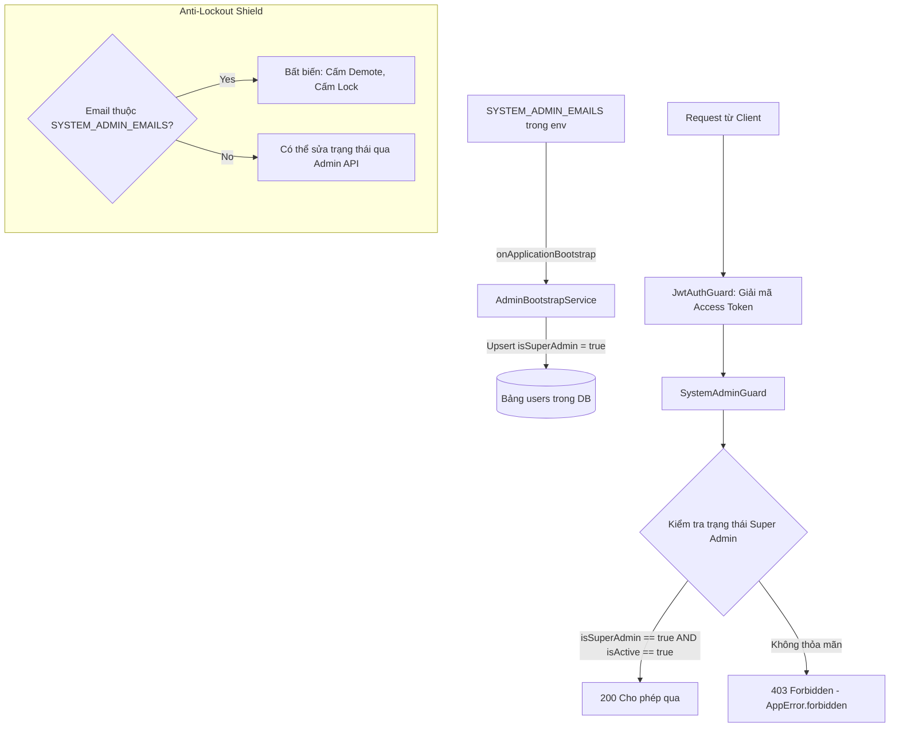
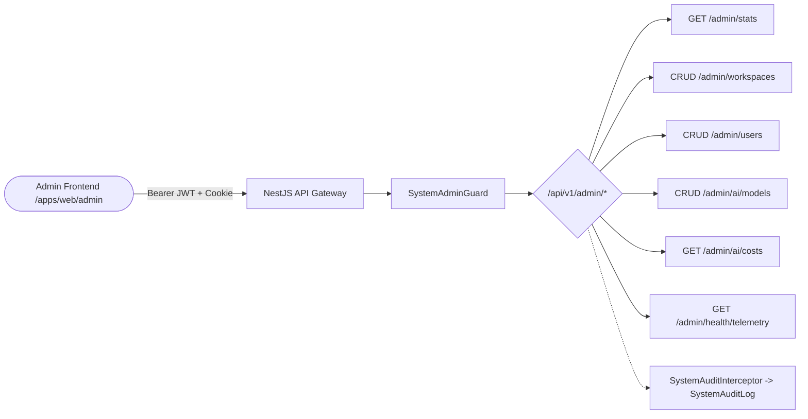
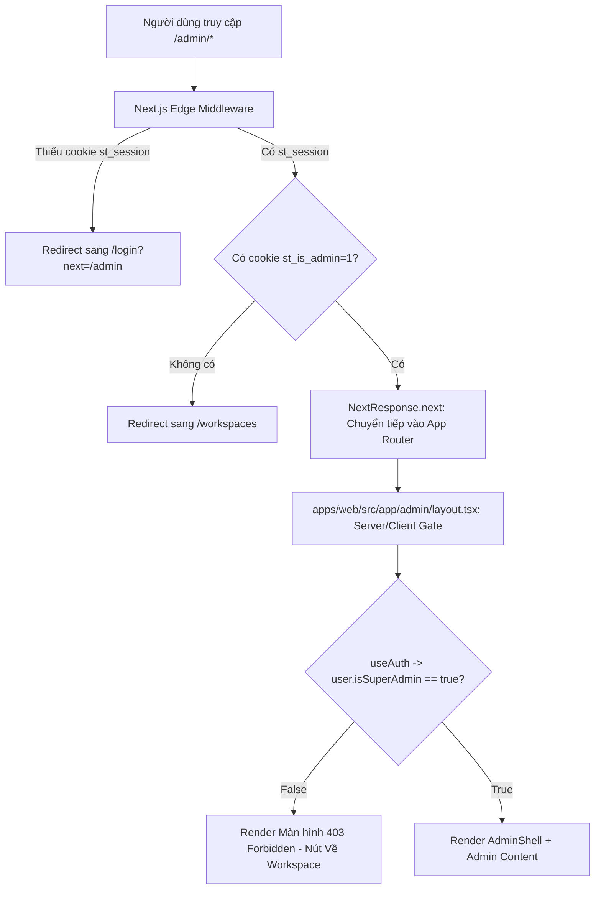
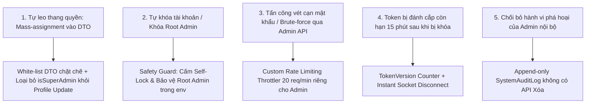
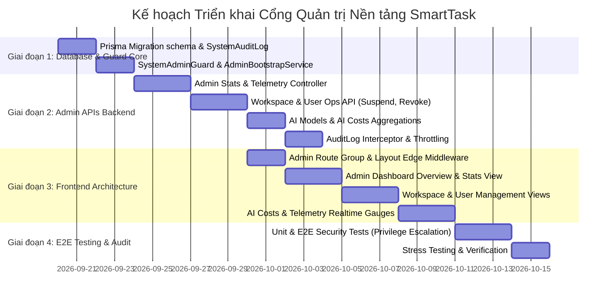

# Tài liệu Thiết kế Kỹ thuật: Cổng Quản trị Nền tảng (Platform / Super Admin)
**Dự án**: SmartTask — Nền tảng Quản lý Công việc & Hợp tác AI Đa Không gian làm việc  
**Phiên bản**: 1.0 (Phase 7b+)  
**Tác giả**: Senior Backend Architect & Senior Frontend Architect  
**Trạng thái**: Bản thảo thiết kế kỹ thuật (Technical RFC)

---

## 1. Bối cảnh & Mục tiêu (Context & Objectives)

Hiện tại, SmartTask là hệ thống SaaS đa khách hàng (Multi-tenant) dựa trên khái niệm **Workspace**. Phân quyền trong hệ thống chủ yếu xoay quanh 4 vai trò của từng workspace: `OWNER`, `ADMIN`, `MEMBER`, `VIEWER` (được bảo vệ bởi `WorkspaceRoleGuard`).

Tuy nhiên, đối với cấp độ **Nền tảng (Platform / System-wide)**:
1. Quản trị viên hệ thống chưa có cổng vận hành tập trung để giám sát tình trạng hoạt động của toàn bộ hạ tầng (workspaces, người dùng, tác vụ, AI token burn-rate, kết nối realtime, tài nguyên DB pool).
2. Việc phân quyền Super Admin hiện đang bị "hardcode" thông qua biến môi trường `SYSTEM_ADMIN_EMAILS` trong `env.schema.ts` (chỉ dùng cục bộ cho 2 API chỉnh sửa danh mục model AI tại `ai-admin.controller.ts`).
3. Thiếu khả năng can thiệp vận hành (Ops capabilities): Khóa workspace vi phạm điều khoản dịch vụ (SUSPENDED), khóa tài khoản người dùng độc hại, thu hồi phiên đăng nhập khẩn cấp (Revoke all active sessions), giám sát chi phí API AI liên tục theo nhà cung cấp (Gemini, Ollama, OpenAI).
4. Thiếu cơ chế ghi vết kiểm toán toàn hệ thống (**System Audit Log**) cho các hành động có tác động lớn của Super Admin.

Tài liệu này định nghĩa kiến trúc kỹ thuật toàn diện cho **Cổng Quản trị Nền tảng (Platform Admin Portal)** trên stack:
- **Backend**: NestJS 11 + Prisma ORM + PostgreSQL 16 + Redis (tùy chọn / Token invalidation cache).
- **Frontend**: Next.js 15 (App Router) + TanStack Query (React Query) + Tailwind CSS v4 + Lucide Icons + Shadcn UI.

---

## 2. Xác thực & Phân quyền Super Admin (Super Admin Auth & Guard)

### 2.1. Đánh giá chuyên sâu: `SYSTEM_ADMIN_EMAILS` vs `User.isSuperAdmin`

| Tiêu chí | Cơ chế hiện tại: `SYSTEM_ADMIN_EMAILS` (Env) | Cơ chế CSDL: `isSuperAdmin: Boolean` (Prisma) | **Giải pháp Đề xuất: Dual-Tier Hybrid Architecture** |
| :--- | :--- | :--- | :--- |
| **Tính linh hoạt (Agility)** | **Thấp**: Phải sửa file `.env`, rebuild/restart server mỗi khi thêm hoặc bớt nhân sự vận hành. | **Cao**: Thăng cấp/giáng cấp (Promote/Demote) trực tiếp qua Web UI / API trong thời gian thực. | **Tối ưu**: Vận hành động qua UI cho các admin thông thường, nhưng bảo lưu danh sách Root Admin bất biến từ hạ tầng. |
| **Bảo mật chống chiếm quyền (Anti-Privilege Escalation)** | **Rất cao**: CSDL bị tấn công SQL Injection cũng không thể tự ý cấp quyền Super Admin nếu không đổi được env của process. | **Trung bình - Rủi ro**: Nếu bất kỳ API update user (`PATCH /me`, `PATCH /users/:id`) bị lỗi mass assignment hoặc thiếu DTO whitelist, attacker có thể tự set `isSuperAdmin = true`. | **Cao nhất**: `User.isSuperAdmin` trong DB xác định quyền, nhưng trường này **bị cấm tuyệt đối** trong các DTO thông thường; đồng thời `SYSTEM_ADMIN_EMAILS` đóng vai trò **Root Admins** không thể bị tước quyền bởi bất kỳ ai trong DB. |
| **Khả năng Truy vấn & Lập chỉ mục** | **Kém**: Muốn tìm các Super Admin phải đọc chuỗi text trong env, query ngược vào DB `email IN (...)`. Không phân trang được. | **Tối ưu**: `WHERE is_super_admin = true`, có B-Tree index, dễ dàng JOIN với activity logs và quản lý. | **Tối ưu**: Truy vấn trực tiếp từ cột `is_super_admin` có index của bảng `users`. |
| **Khả năng Audit Trail** | **Không có**: Không biết ai đã thêm email vào env, vào lúc nào, lý do gì. | **Đầy đủ**: Đi kèm `SystemAuditLog` lưu ai promote, thời gian, IP, lý do cấp quyền. | **Đầy đủ**: Mọi biến động quyền Super Admin đều được ghi vào `SystemAuditLog`. |
| **Khởi tạo hệ thống (Bootstrapping / Break-glass)** | **Tự nhiên**: Ngay lần chạy đầu tiên đã có Super Admin mà không cần seed dữ liệu đặc biệt. | **Khó khăn**: "Con gà và quả trứng" — khi DB trắng trơn, ai cấp quyền cho Super Admin đầu tiên? | **Hoàn hảo**: Server khởi động sẽ tự đồng bộ `SYSTEM_ADMIN_EMAILS` vào DB (`isSuperAdmin = true`). Nếu mất quyền admin qua UI, biến env đóng vai trò break-glass khẩn cấp. |

### 2.2. Thiết kế Cơ chế Dual-Tier Hybrid Architecture



1. **Khởi tạo & Đồng bộ (Bootstrapping)**:
   Khi NestJS khởi động (`onApplicationBootstrap`), `AdminBootstrapService` đọc danh sách `SYSTEM_ADMIN_EMAILS` từ `ConfigService`:
   - Với mỗi email, thực hiện update `isSuperAdmin = true` trong bảng `users` (nếu user đã tồn tại).
   - Nếu user chưa tồn tại, ghi nhận log cảnh báo: User chưa đăng ký tài khoản.
2. **Quy tắc Bất biến (Root Admin Immutability)**:
   - Các tài khoản có email trùng với `SYSTEM_ADMIN_EMAILS` được đánh dấu là **Root Admin**.
   - API quản trị **từ chối 400 Bad Request** mọi thao tác cố gắng:
     - Đổi `isActive = false` của Root Admin.
     - Đổi `isSuperAdmin = false` của Root Admin.
     - Xóa vĩnh viễn tài khoản của Root Admin.
   - Điều này triệt tiêu hoàn toàn rủi ro **Lockout** hoặc tấn công nội bộ (một admin rogue tước quyền tất cả các admin khác).

### 2.3. Cấu trúc Prisma Schema Bổ sung

```prisma
// File: apps/api/prisma/schema.prisma

enum WorkspaceStatus {
  ACTIVE
  SUSPENDED
  ARCHIVED
}

model User {
  id                  String    @id @default(uuid()) @db.Uuid
  email               String    @unique @db.Citext
  passwordHash        String    @map("password_hash")
  fullName            String    @map("full_name")
  shortName           String?   @map("short_name")
  avatarUrl           String?   @map("avatar_url")
  timezone            String    @default("Asia/Ho_Chi_Minh")
  weeklyCapacityHours Int?      @map("weekly_capacity_hours")
  notificationPrefs   Json      @default("{}") @map("notification_prefs")
  aiPersonalPrompt    String?   @map("ai_personal_prompt")
  isActive            Boolean   @default(true) @map("is_active")
  
  /// Cờ xác định quyền Quản trị Nền tảng toàn hệ thống (Super Admin)
  isSuperAdmin        Boolean   @default(false) @map("is_super_admin")
  
  /// Session generation counter dùng để thu hồi token tức thì không cần stateful session
  tokenVersion        Int       @default(0) @map("token_version")
  
  lastLoginAt         DateTime? @map("last_login_at")
  createdAt           DateTime  @default(now()) @map("created_at")
  updatedAt           DateTime  @updatedAt @map("updated_at")

  // Quan hệ hiện tại giữ nguyên...
  // Thêm quan hệ với SystemAuditLog:
  auditLogsTriggered  SystemAuditLog[] @relation("AuditActor")

  @@index([isSuperAdmin])
  @@index([isActive])
  @@map("users")
}

model Workspace {
  id         String          @id @default(uuid()) @db.Uuid
  name       String
  slug       String          @unique
  logoUrl    String?         @map("logo_url")
  ownerId    String          @map("owner_id") @db.Uuid
  settings   Json            @default("{}")
  
  /// Trạng thái hoạt động của Workspace (ACTIVE, SUSPENDED, ARCHIVED)
  status     WorkspaceStatus @default(ACTIVE)
  
  /// Lý do bị tạm khóa hệ thống (nếu status = SUSPENDED)
  suspendReason String?      @map("suspend_reason")
  suspendedAt   DateTime?    @map("suspended_at")
  
  archivedAt DateTime?       @map("archived_at")
  createdAt  DateTime        @default(now()) @map("created_at")
  updatedAt  DateTime        @updatedAt @map("updated_at")

  // Quan hệ hiện tại giữ nguyên...
  @@index([status])
  @@map("workspaces")
}

/// Sổ nhật ký kiểm toán hệ thống bắt buộc cho toàn bộ thao tác Super Admin
model SystemAuditLog {
  id          String   @id @default(uuid()) @db.Uuid
  actorId     String   @map("actor_id") @db.Uuid
  action      String   @db.VarChar(100) // e.g., 'WORKSPACE.SUSPEND', 'USER.REVOKE_SESSIONS', 'AI_MODEL.UPSERT'
  targetType  String   @map("target_type") @db.VarChar(50) // 'WORKSPACE', 'USER', 'AI_MODEL', 'SYSTEM'
  targetId    String?  @map("target_id") @db.VarChar(100)
  ipAddress   String?  @map("ip_address") @db.VarChar(45)
  userAgent   String?  @map("user_agent")
  beforeState Json?    @map("before_state")
  afterState  Json?    @map("after_state")
  reason      String?  @db.Text
  createdAt   DateTime @default(now()) @map("created_at")

  actor User @relation("AuditActor", fields: [actorId], references: [id], onDelete: Restrict)

  @@index([actorId, createdAt])
  @@index([action, createdAt])
  @@index([targetType, targetId])
  @@map("system_audit_logs")
}
```

### 2.4. Triển khai Mã nguồn Backend NestJS

#### Decorator `@SystemAdmin()`
```typescript
// apps/api/src/common/decorators/system-admin.decorator.ts
import { SetMetadata } from '@nestjs/common';

export const SYSTEM_ADMIN_KEY = 'isSystemAdminRequired';

/**
 * Đánh dấu endpoint chỉ dành cho Quản trị viên Nền tảng (Platform / Super Admin).
 * Khi gắn decorator này, SystemAdminGuard sẽ kiểm tra quyền sở hữu cờ isSuperAdmin của User.
 */
export const SystemAdmin = () => SetMetadata(SYSTEM_ADMIN_KEY, true);
```

#### Guard `SystemAdminGuard`
```typescript
// apps/api/src/common/guards/system-admin.guard.ts
import { CanActivate, ExecutionContext, Injectable } from '@nestjs/common';
import { Reflector } from '@nestjs/core';
import { AppError } from '../app-error';
import { SYSTEM_ADMIN_KEY } from '../decorators/system-admin.decorator';
import { PrismaService } from '../../prisma/prisma.service';
import type { Request } from 'express';
import type { JwtUser } from '../decorators/current-user.decorator';

export interface AdminUserContext extends JwtUser {
  isSuperAdmin: boolean;
}

@Injectable()
export class SystemAdminGuard implements CanActivate {
  constructor(
    private readonly reflector: Reflector,
    private readonly prisma: PrismaService,
  ) {}

  async canActivate(context: ExecutionContext): Promise<boolean> {
    const isRequired = this.reflector.getAllAndOverride<boolean | undefined>(
      SYSTEM_ADMIN_KEY,
      [context.getHandler(), context.getClass()],
    );

    // Không gắn @SystemAdmin() thì cho qua (route thường do JwtAuthGuard và WorkspaceRoleGuard xử lý)
    if (!isRequired) return true;

    const req = context.switchToHttp().getRequest<Request & { user?: JwtUser; adminUser?: AdminUserContext }>();
    if (!req.user || !req.user.id) {
      throw AppError.unauthorized();
    }

    // Không chỉ tin cậy hoàn toàn vào JWT payload (có thể stale trong 15p access token TTL),
    // truy vấn DB trạng thái active và isSuperAdmin hiện thời:
    const user = await this.prisma.user.findUnique({
      where: { id: req.user.id },
      select: { id: true, email: true, isActive: true, isSuperAdmin: true, tokenVersion: true },
    });

    if (!user || !user.isActive || !user.isSuperAdmin) {
      throw AppError.forbidden({
        code: 'SUPER_ADMIN_REQUIRED',
        message: 'Bạn không có quyền truy cập Cổng Quản trị Nền tảng SmartTask.',
      });
    }

    req.adminUser = {
      id: user.id,
      email: user.email,
      isSuperAdmin: true,
    };

    return true;
  }
}
```

---

## 3. Thiết kế Chi tiết API Endpoints (`/api/v1/admin/*`)

Toàn bộ các endpoint được nhóm trong module `AdminModule` (`apps/api/src/admin/`), tiền tố URL thống nhất: `/api/v1/admin`. Tất cả endpoints bắt buộc phải vượt qua `JwtAuthGuard` và `SystemAdminGuard`.



---

### 3.1. `GET /api/v1/admin/stats` — Thống kê Tổng quan Nền tảng

- **Mô tả**: Dashboard Executive tổng quan phục vụ việc theo dõi sức khỏe kinh doanh và kỹ thuật của hệ thống.
- **Tần suất gọi**: Cache 30 giây (Redis / in-memory cache) để tránh tính toán aggregations quá tải cho DB.

#### Response DTO (`AdminStatsResponseDto`)
```json
{
  "workspaces": {
    "total": 142,
    "active": 136,
    "suspended": 4,
    "archived": 2,
    "growthRateThisMonth": 12.5
  },
  "users": {
    "total": 1280,
    "active": 1250,
    "suspended": 30,
    "activeToday": 412,
    "activeThisWeek": 980
  },
  "tasks": {
    "total": 24500,
    "completed": 18200,
    "inProgress": 4100,
    "overdue": 320,
    "createdLast7Days": 1280
  },
  "ai": {
    "totalTurns": 65420,
    "turnsToday": 1820,
    "successRate": 99.4,
    "avgLatencyMs": 1150
  },
  "tokenBurnRate": {
    "last24Hours": {
      "inputTokens": 4500000,
      "outputTokens": 820000,
      "cachedInputTokens": 1200000,
      "totalTokens": 6520000,
      "estimatedCostUsd": 4.85,
      "estimatedCostVnd": 121250
    },
    "last30Days": {
      "inputTokens": 110000000,
      "outputTokens": 21000000,
      "cachedInputTokens": 32000000,
      "totalTokens": 163000000,
      "estimatedCostUsd": 128.40,
      "estimatedCostVnd": 3210000
    }
  }
}
```

#### Kỹ thuật Truy vấn Tối ưu
Sử dụng `Promise.all` kết hợp với query count và Prisma `aggregate`:
```typescript
const [wsCounts, userCounts, taskCounts, tokenStats24h, tokenStats30d] = await Promise.all([
  this.prisma.workspace.groupBy({ by: ['status'], _count: { id: true } }),
  this.prisma.user.aggregate({ _count: { id: true }, where: { isActive: true } }),
  this.prisma.task.groupBy({ by: ['columnId'], _count: { id: true } }),
  this.prisma.aiTokenLog.aggregate({
    where: { createdAt: { gte: since24h } },
    _sum: { inputTokens: true, outputTokens: true, cachedInputTokens: true, estimatedCost: true },
    _count: { id: true },
  }),
  this.prisma.aiTokenLog.aggregate({
    where: { createdAt: { gte: since30d } },
    _sum: { inputTokens: true, outputTokens: true, cachedInputTokens: true, estimatedCost: true },
  }),
]);
```

---

### 3.2. Quản lý Workspaces (`/api/v1/admin/workspaces/*`)

#### 1. `GET /api/v1/admin/workspaces`
- **Query Params**:
  - `page`: number (default: 1)
  - `limit`: number (default: 20, max: 100)
  - `search`: string (tìm theo `name`, `slug`, `owner.email`)
  - `status`: enum `ACTIVE | SUSPENDED | ARCHIVED`
  - `sortBy`: `createdAt | memberCount | taskCount | aiCost` (default: `createdAt`)
  - `sortOrder`: `asc | desc`
- **Response**: Trả về danh sách workspace kèm thông tin Owner, tổng số thành viên (`_count.members`), tổng số dự án (`_count.projects`), tổng chi phí AI và thời gian tạo.

#### 2. `PATCH /api/v1/admin/workspaces/:id/status`
- **Quyền hạn**: `@SystemAdmin()`
- **Request Body**:
  ```typescript
  export class UpdateWorkspaceStatusDto {
    @IsEnum(WorkspaceStatus)
    status: WorkspaceStatus; // ACTIVE | SUSPENDED

    @IsString()
    @MinLength(5)
    @MaxLength(500)
    reason: string; // Bắt buộc nhập lý do để ghi Audit Log
  }
  ```
- **Xử lý Nghiệp vụ khi SUSPENDED**:
  1. Update `workspaces.status = SUSPENDED`, `workspaces.suspend_reason = reason`, `workspaces.suspended_at = now()`.
  2. Bắn sự kiện nội bộ qua `EventEmitter`: `workspace.suspended`.
  3. Realtime Listener ngắt mọi kết nối socket đang subscribe vào các phòng thuộc workspace này:
     `realtimeGateway.kickWorkspace(workspaceId, 'Không gian làm việc đã bị tạm ngưng bởi Quản trị viên hệ thống.')`.
  4. Middleware / `WorkspaceAccessService` khi kiểm tra quyền truy cập của user vào workspace này sẽ chặn ngay `403 Forbidden` với mã lỗi `WORKSPACE_SUSPENDED`.
  5. Ghi `SystemAuditLog` với `beforeState` và `afterState`.

#### 3. `GET /api/v1/admin/workspaces/:id/usage`
- **Mô tả**: Xem chi tiết mức sử dụng tài nguyên của một Workspace cụ thể:
  - Băng thông và dung lượng lưu trữ: `attachments` tổng bytes, số lượng file.
  - Phân bổ thành viên theo vai trò (OWNER, ADMIN, MEMBER, VIEWER).
  - Khối lượng công việc: Số project, sprint active, task theo priority.
  - Hạn ngạch & Chi phí AI: Token log 30 ngày, số lượt dùng AI chat, proposal chấp nhận vs từ chối.

---

### 3.3. Quản lý Người dùng (`/api/v1/admin/users/*`)

#### 1. `GET /api/v1/admin/users`
- **Query Params**: `page`, `limit`, `search` (email, full_name), `isActive`, `isSuperAdmin`, `sortBy`, `sortOrder`.
- **Response**: Danh sách người dùng, trạng thái, ngày đăng nhập gần nhất, số workspace tham gia, cờ `isSuperAdmin`.

#### 2. `PATCH /api/v1/admin/users/:id/status`
- **Request Body**:
  ```typescript
  export class UpdateUserStatusDto {
    @IsBoolean()
    isActive: boolean;

    @IsOptional()
    @IsString()
    reason?: string;
  }
  ```
- **Ràng buộc An toàn Cốt tử (Safety Constraints)**:
  - **Self-lockout check**: `if (req.adminUser.id === targetUserId && !isActive) throw AppError.badRequest('Bạn không thể tự khóa tài khoản của chính mình.')`.
  - **Root Admin Shield**: `if (isRootAdmin(targetUser.email)) throw AppError.badRequest('Không thể thay đổi trạng thái của Root Admin hệ thống.')`.
- **Hệ quả khi `isActive = false`**:
  - Hủy ngay toàn bộ refresh tokens trong DB:
    `prisma.refreshToken.updateMany({ where: { userId, revokedAt: null }, data: { revokedAt: new Date() } })`.
  - Tăng `tokenVersion`: `prisma.user.update({ where: { id: userId }, data: { tokenVersion: { increment: 1 } } })`.
  - Socket Gateway gửi lệnh disconnect client của user đó.
  - Ghi `SystemAuditLog`.

#### 3. `POST /api/v1/admin/users/:id/revoke-sessions`
- **Mô tả**: Đăng xuất cưỡng chế (Force Logout) người dùng khỏi mọi thiết bị trong trường hợp phát hiện tài khoản bị xâm nhập hoặc rò rỉ token.
- **Cơ chế Triển khai (Instant Invalidation)**:
  - Đánh dấu `revokedAt = now()` cho toàn bộ refresh token.
  - Tăng `tokenVersion` lên 1. Mọi access token cũ mang `tokenVersion` cũ khi kiểm tra tại Guard sẽ bị từ chối ngay lập tức mà không cần đợi hết hạn TTL 15 phút.
  - Realtime: `realtimeGateway.disconnectUser(userId)`.
  - Ghi `SystemAuditLog`.

#### 4. `POST /api/v1/admin/users/:id/role`
- **Mô tả**: Thăng cấp hoặc hạ cấp quyền Super Admin (`isSuperAdmin: boolean`).
- **Ràng buộc**:
  - Root Admin trong `SYSTEM_ADMIN_EMAILS` không thể bị hạ cấp qua API này.
  - Bắt buộc nhập mật khẩu của Admin hiện tại để xác thực lại (Re-authentication) trước khi cấp quyền tối cao.

---

### 3.4. Quản lý AI Models Toàn Hệ thống (`/api/v1/admin/ai/models/*`)

Chuẩn hóa toàn bộ endpoint từ `ai-admin.controller.ts` cũ (`/ai-config/models`) chuyển về chuẩn RESTful `/api/v1/admin/ai/models`:

| Phương thức | Tuyến đường | Mô tả |
| :--- | :--- | :--- |
| `GET` | `/api/v1/admin/ai/models` | Lấy danh mục model toàn hệ thống (bao gồm cả model inactive). Hỗ trợ filter provider (`gemini`, `ollama`, `openai`). |
| `POST` | `/api/v1/admin/ai/models` | Khai báo model mới vào hệ thống: provider, model ID, capabilities (VISION, REASONING, FUNCTION_CALLING), inputCostPerMillion, outputCostPerMillion, cachedInputCostPerMillion, contextWindow, isActive. |
| `PATCH` | `/api/v1/admin/ai/models/:id` | Sửa biểu phí, cập nhật độ ưu tiên sắp xếp (`sortOrder`), bật/tắt kích hoạt (`isActive`). |
| `POST` | `/api/v1/admin/ai/models/:id/test` | Ping thử nghiệm kết nối và đo độ trễ thực tế đến nhà cung cấp. |

---

### 3.5. `GET /api/v1/admin/ai/costs` — Phân tích & Giám sát Chi phí AI

Endpoint phân tích chi phí toàn diện theo thời gian, giúp Quản trị viên nắm bắt được tình trạng đốt tiền API và phát hiện bất thường:

- **Query Params**:
  - `from`: ISO Date String (default: 30 ngày trước)
  - `to`: ISO Date String (default: hiện tại)
  - `groupBy`: `provider | model | workspace | day | week`
- **Output Schema**:
  ```json
  {
    "summary": {
      "totalTokens": 145000000,
      "totalCostUsd": 114.25,
      "totalCostVnd": 2856250,
      "totalTurns": 45200,
      "avgCostPerTurnUsd": 0.0025
    },
    "byProvider": [
      { "provider": "gemini", "tokens": 120000000, "costUsd": 89.50, "percentage": 78.3 },
      { "provider": "ollama", "tokens": 25000000, "costUsd": 0.00, "percentage": 0.0 }
    ],
    "topWorkspaces": [
      { "workspaceId": "uuid-1", "workspaceName": "SmartTask Demo", "costUsd": 45.20, "turnCount": 18200 },
      { "workspaceId": "uuid-2", "workspaceName": "Dev Team Alpha", "costUsd": 38.10, "turnCount": 15400 }
    ],
    "timeline": [
      { "date": "2026-09-01", "tokens": 4200000, "costUsd": 3.40 },
      { "date": "2026-09-02", "tokens": 4800000, "costUsd": 3.90 }
    ]
  }
  ```

---

### 3.6. `GET /api/v1/admin/health/telemetry` — Giám sát Hạ tầng & Vận hành Kỹ thuật

Mở rộng từ `/health` đơn giản hiện tại thành telemetry endpoint toàn diện dành riêng cho Super Admin:

```json
{
  "status": "healthy",
  "timestamp": "2026-09-19T13:35:00.000Z",
  "uptimeSeconds": 864000,
  "system": {
    "nodeVersion": "v22.12.0",
    "memory": {
      "rssMb": 185.4,
      "heapTotalMb": 120.5,
      "heapUsedMb": 88.2,
      "externalMb": 14.1,
      "heapUtilizationPercentage": 73.2
    },
    "cpu": {
      "userMicroseconds": 450123000,
      "systemMicroseconds": 89123000
    },
    "eventLoop": {
      "latencyP95Ms": 4.2,
      "latencyP99Ms": 12.8
    }
  },
  "database": {
    "status": "connected",
    "pingLatencyMs": 3.5,
    "pool": {
      "activeConnections": 8,
      "idleConnections": 12,
      "totalConnections": 20,
      "maxLimit": 30,
      "waitingQueries": 0
    },
    "tableSizesTop5": [
      { "table": "ai_token_logs", "rowCountEstimate": 250000, "sizeMb": 85.2 },
      { "table": "tasks", "rowCountEstimate": 45000, "sizeMb": 24.1 },
      { "table": "activity_logs", "rowCountEstimate": 85000, "sizeMb": 18.5 }
    ]
  },
  "realtime": {
    "status": "online",
    "connectedSockets": 142,
    "activeProjectRooms": 28,
    "activeUserRooms": 135
  }
}
```

- **Query DB Stats**: Thực thi qua Prisma `$queryRaw`:
  ```sql
  SELECT count(*) as total, 
         count(*) FILTER (WHERE state = 'active') as active,
         count(*) FILTER (WHERE state = 'idle') as idle
  FROM pg_stat_activity 
  WHERE datname = current_database();
  ```

---

## 4. Kiến trúc Frontend Quản trị Nền tảng (`apps/web/src/app/admin/*`)

### 4.1. Phân tách Layout: `AdminShell` vs `AppShell`

Hiện tại, `apps/web/src/components/app/AppShell.tsx` được thiết kế chặt chẽ theo cấu trúc **Project / Workspace** (chứa Selector Workspace, Menu Project, Sprint, Kanban, Chat AI Drawer, v.v.).

Việc cố tình nhét trang Quản trị Nền tảng vào `AppShell` sẽ gây:
- Rối loạn tư duy người dùng (Mental Model Mismatch): Admin nền tảng làm việc trên quy mô đa workspace, không bị giới hạn trong workspace đang chọn.
- Xung đột trạng thái URL & Context (`useWorkspace()`, `useProject()`).

**Giải pháp**: Tách route group riêng biệt với Layout chuyên biệt:

```
apps/web/src/app/
├── (auth)/
│   └── login/
├── (dashboard)/               <-- Cho người dùng & workspace thông thường
│   ├── layout.tsx             <-- Dùng AppShell (Workspace context)
│   ├── workspaces/
│   ├── projects/[projectId]/
│   └── settings/
└── admin/                     <-- CỔNG QUẢN TRỊ NỀN TẢNG (MISSION CONTROL)
    ├── layout.tsx             <-- Dùng AdminShell độc lập
    ├── page.tsx               <-- Overview Dashboard (/admin)
    ├── workspaces/
    │   ├── page.tsx           <-- Quản lý Workspace
    │   └── [workspaceId]/page.tsx
    ├── users/
    │   └── page.tsx           <-- Quản lý Người dùng & Phiên
    ├── ai/
    │   ├── models/page.tsx    <-- Quản lý Danh mục Model
    │   └── costs/page.tsx     <-- Báo cáo Chi phí AI Toàn sàn
    ├── telemetry/
    │   └── page.tsx           <-- DB Pool, Memory, Sockets Telemetry
    └── audit-logs/
        └── page.tsx           <-- Lịch sử Nhật ký Vận hành
```

### 4.2. Bảo vệ Tuyến đường Đa tầng (Edge Middleware & Server Component Guard)



#### Cập nhật `apps/web/src/middleware.ts`
```typescript
import { NextResponse, type NextRequest } from "next/server";
import { SESSION_FLAG_COOKIE } from "@/lib/auth-cookie";

export const ADMIN_FLAG_COOKIE = "st_is_admin";

export function middleware(req: NextRequest) {
  const { pathname, search } = req.nextUrl;
  const hasSession = req.cookies.has(SESSION_FLAG_COOKIE);

  // Bảo vệ route /admin tại tầng Edge
  if (pathname.startsWith("/admin")) {
    if (!hasSession) {
      const url = new URL("/login", req.url);
      url.searchParams.set("next", pathname + search);
      return NextResponse.redirect(url);
    }
    // Kiểm tra cờ admin nhanh để tránh render nháy màn hình
    const isAdmin = req.cookies.get(ADMIN_FLAG_COOKIE)?.value === "1";
    if (!isAdmin) {
      return NextResponse.redirect(new URL("/workspaces", req.url));
    }
    return NextResponse.next();
  }

  // Logic cũ cho login và user thường giữ nguyên...
  if (pathname.startsWith("/login")) {
    if (hasSession) return NextResponse.redirect(new URL("/workspaces", req.url));
    return NextResponse.next();
  }
  if (!hasSession) {
    const url = new URL("/login", req.url);
    url.searchParams.set("next", pathname + search);
    return NextResponse.redirect(url);
  }
  return NextResponse.next();
}

export const config = {
  matcher: ["/((?!_next|api|favicon.ico|.*\\..*).*)"],
};
```

#### `apps/web/src/app/admin/layout.tsx`
```tsx
"use client";

import * as React from "react";
import { useAuth } from "@/lib/auth";
import { AdminShell } from "@/components/admin/AdminShell";
import { Skeleton } from "@/components/ui/skeleton";
import { ShieldAlert, ArrowLeft } from "lucide-react";
import { Button } from "@/components/ui/button";
import Link from "next/link";

export default function AdminLayout({ children }: { children: React.ReactNode }) {
  const { user, status } = useAuth();

  if (status === "loading") {
    return (
      <div className="flex min-h-screen bg-slate-950">
        <Skeleton className="w-64 h-screen bg-slate-900 rounded-none" />
        <div className="flex-1 p-8 space-y-6">
          <Skeleton className="h-12 w-96 bg-slate-900" />
          <div className="grid grid-cols-4 gap-6">
            {[1, 2, 3, 4].map((i) => (
              <Skeleton key={i} className="h-32 bg-slate-900" />
            ))}
          </div>
          <Skeleton className="h-96 bg-slate-900" />
        </div>
      </div>
    );
  }

  if (status === "anonymous" || !user?.isSuperAdmin) {
    return (
      <div className="flex min-h-screen flex-col items-center justify-center bg-slate-950 text-white p-4">
        <div className="max-w-md w-full p-8 bg-slate-900 border border-red-900/50 rounded-2xl text-center space-y-4 shadow-2xl">
          <div className="w-16 h-16 bg-red-950/60 border border-red-800/80 rounded-2xl mx-auto flex items-center justify-center text-red-400">
            <ShieldAlert className="w-8 h-8" />
          </div>
          <h1 className="text-2xl font-bold tracking-tight">Khu vực Giới hạn</h1>
          <p className="text-sm text-slate-400 leading-relaxed">
            Bạn không có quyền truy cập Cổng Quản trị Nền tảng SmartTask. Tài khoản của bạn cần được cấp cờ <code>isSuperAdmin</code>.
          </p>
          <div className="pt-2">
            <Button asChild variant="outline" className="w-full border-slate-700 hover:bg-slate-800 text-slate-200">
              <Link href="/workspaces">
                <ArrowLeft className="w-4 h-4 mr-2" /> Về Không gian làm việc
              </Link>
            </Button>
          </div>
        </div>
      </div>
    );
  }

  return <AdminShell user={user}>{children}</AdminShell>;
}
```

### 4.3. Thiết kế Giao diện `AdminShell` (Mission Control Look & Feel)

- **Theme & Cảm quan**: Nền tối kỹ thuật (`bg-slate-950`), viền kim loại (`border-slate-800`), điểm nhấn màu Ruby/Crimson (`#ef4444` / `#f43f5e`) hoặc Indigo công nghệ để phân biệt hoàn toàn với màu xanh Blue/Cyan của Workspace thông thường.
- **Header thanh công cụ**:
  - Badge nổi bật: `SUPER ADMIN OPS MODE` nhấp nháy đèn xanh telemetry.
  - Phím tắt nhanh: Tìm kiếm toàn hệ thống (Search Workspaces / Users qua `Cmd + K`).
  - Nút chuyển nhanh: "Quay về App thường" không cần đăng xuất.
- **Sidebar danh mục điều hướng**:
  - 📊 **Tổng quan**: `/admin` (Stats, Burn-rate, Biểu đồ tăng trưởng).
  - 🏢 **Workspaces**: `/admin/workspaces` (Danh sách, đình chỉ, giới hạn tài nguyên).
  - 👥 **Người dùng**: `/admin/users` (Phân quyền, khóa tài khoản, revoke session).
  - 🤖 **AI Platform**:
    - Danh mục Model: `/admin/ai/models`
    - Chi phí & Tiêu thụ Token: `/admin/ai/costs`
  - 🩺 **Hạ tầng Telemetry**: `/admin/telemetry` (DB connection pool, Memory, WebSockets).
  - 📜 **Nhật ký Kiểm toán**: `/admin/audit-logs` (Lịch sử thao tác Super Admin).

### 4.4. React Query Hooks Kiến trúc (`apps/web/src/features/admin/hooks/*`)

Được module hóa sạch sẽ theo chuẩn SmartTask:
- `useAdminStats()`: Polling mỗi 60 giây hoặc refresh thủ công.
- `useAdminWorkspaces(filters)`: Hỗ trợ debounced search, phân trang, lọc status.
- `useUpdateWorkspaceStatus()`: Mutation kèm invalidate query và toast thông báo.
- `useAdminUsers(filters)`: Danh sách người dùng hệ thống.
- `useRevokeUserSessions()`: Mutation cưỡng chế đăng xuất người dùng.
- `useAdminAiModels()`, `useUpsertAiModel()`: Quản lý danh mục model.
- `useAdminAiCosts(params)`: Dữ liệu phân tích chi phí token.
- `useAdminTelemetry()`: Polling live metrics 5 giây/lần cho trang Telemetry.

---

## 5. Rà soát & Tối ưu An ninh Hệ thống (Security Risks & Hardening)



### 5.1. Chống Leo thang Đặc quyền (Privilege Escalation Protection)

1. **Ngăn chặn triệt để Mass Assignment**:
   - `UpdateProfileDto` tại `apps/api/src/users/dto/update-profile.dto.ts` CHỈ chấp nhận: `{ fullName, shortName, avatarUrl, timezone }`.
   - Cấu hình toàn cục NestJS `ValidationPipe` với `{ whitelist: true, forbidNonWhitelisted: true }` đảm bảo nếu client cố tình gửi `{ isSuperAdmin: true }` vào `PATCH /me`, request sẽ lập tức bị ném lỗi `400 Bad Request`.
   - Prisma Service trong `UsersService.updateProfile` chỉ `update` đúng các trường được trích xuất tường minh, không bao giờ dùng `data: dto as any`.
2. **Cơ chế Thăng quyền An toàn (Promote Super Admin Gate)**:
   - Thao tác cấp cờ `isSuperAdmin = true` cho người khác bắt buộc phải qua endpoint riêng `POST /api/v1/admin/users/:id/role`.
   - Endpoint này yêu cầu Admin thực hiện phải xác thực lại mật khẩu (Sudo mode / Password Re-verification).
   - Không được phép tự cấp quyền hoặc tự tước quyền của chính mình.
3. **Root Admin Immutability (Bất biến từ Hạ tầng)**:
   - Danh sách email trong `SYSTEM_ADMIN_EMAILS` (từ file môi trường máy chủ) là danh tính gốc.
   - Code logic từ chối mọi thao tác sửa đổi quyền hoặc khóa tài khoản của các Root Admin này.

### 5.2. Rate Limiting Chuyên biệt cho Quản trị Viên

Mặc dù Super Admin là tài khoản tin cậy, nhưng rủi ro credential stuffing hoặc script tự động hóa bị lỗi vòng lặp vô tận (infinite loop) có thể làm tê liệt DB:

```typescript
// Cấu hình rate limit riêng cho Admin Module
ThrottlerModule.forRootAsync({
  inject: [ConfigService],
  useFactory: (config: ConfigService<Env, true>) => [
    {
      name: 'default',
      ttl: 60_000,
      limit: config.get('RATE_LIMIT_PER_MINUTE', { infer: true }), // 100 req/min
    },
    {
      name: 'admin-mutation',
      ttl: 60_000,
      limit: 20, // Chỉ 20 thao tác thay đổi nhạy cảm mỗi phút
    },
  ],
})
```
Gắn `@Throttle({ 'admin-mutation': { limit: 20, ttl: 60_000 } })` trên các thao tác:
- `PATCH /admin/workspaces/:id/status`
- `PATCH /admin/users/:id/status`
- `POST /admin/users/:id/revoke-sessions`
- `POST /admin/ai/models`

### 5.3. Bắt buộc Ghi vết Kiểm toán Toàn diện (`SystemAuditLog`)

Mọi thao tác quản trị nền tảng có khả năng làm thay đổi dữ liệu hoặc trạng thái hệ thống PHẢI được ghi vào bảng `SystemAuditLog`:
- **Nguyên tắc Append-Only**: Bảng `system_audit_logs` trong CSDL không có bất kỳ API `DELETE` hay `UPDATE` nào. Cấm CASCADE delete từ bảng khác.
- **SystemAuditInterceptor**:
  Tự động bắt context sau khi controller thực thi thành công:
  - `actorId`: ID của Super Admin đang đăng nhập.
  - `action`: Tên hành động chuẩn hóa (`WORKSPACE.SUSPEND`, `USER.REVOKE_SESSIONS`, `AI_MODEL.UPDATE_PRICE`).
  - `ipAddress`: Lấy từ `req.headers['x-forwarded-for']` hoặc `req.socket.remoteAddress`.
  - `userAgent`: Chuỗi Client User-Agent.
  - `beforeState` & `afterState`: Snapshot dữ liệu trước và sau khi thay đổi (lưu dạng JSONB để diff trực quan trên UI).
  - `reason`: Chuỗi lý do bắt buộc admin phải nhập từ Modal xác nhận.

### 5.4. Cơ chế Thu hồi Phiên tức thì (Instant Session Revocation)

Vấn đề của JWT Stateless: Sau khi Admin khóa tài khoản hoặc ấn "Thu hồi phiên", Access Token cũ (TTL 15 phút) vẫn có thể gửi request hợp lệ nếu server chỉ verify chữ ký mật mã.

**Giải pháp SmartTask Dual-Revoke Engine**:
1. **Lớp Refresh Token**:
   Thu hồi toàn bộ bản ghi `RefreshToken` trong DB (`revokedAt = now()`), ngăn chặn mọi lần cấp mới token.
2. **Lớp Access Token (Token Version Strategy)**:
   - Thêm cột `tokenVersion Int @default(0)` vào bảng `User`.
   - Access Token JWT payload mang theo `tv: user.tokenVersion`.
   - Khi Super Admin bấm "Revoke Sessions" hoặc "Khóa tài khoản", backend tăng `tokenVersion: { increment: 1 }`.
   - Tại `JwtAuthGuard` (hoặc `SystemAdminGuard` đối với admin routes): Kiểm tra `payload.tv === user.tokenVersion`. Nếu lệch, từ chối ngay lập tức `401 Unauthorized - SESSION_REVOKED`.
3. **Lớp Realtime (WebSocket Kick)**:
   - Phát tín hiệu ngắt socket: `this.server.to(`user:${userId}`).disconnectSockets(true)`.

---

## 6. Lộ trình Triển khai Chi tiết (Implementation Roadmap)



1. **Giai đoạn 1: Nền tảng Dữ liệu & Cơ chế Bảo vệ Cốt lõi (Tuần 1)**
   - Cập nhật `schema.prisma`: Thêm `User.isSuperAdmin`, `User.tokenVersion`, `Workspace.status`, `SystemAuditLog`.
   - Tạo và chạy Prisma migration.
   - Viết `AdminBootstrapService` đồng bộ `SYSTEM_ADMIN_EMAILS`.
   - Xây dựng `@SystemAdmin()` decorator và `SystemAdminGuard`.
2. **Giai đoạn 2: Phát triển Hệ thống API Quản trị Backend (Tuần 1 - 2)**
   - Xây dựng `AdminModule` và các service tính toán `AdminStatsService`, `AdminWorkspacesService`, `AdminUsersService`, `AdminAiService`, `AdminTelemetryService`.
   - Triển khai `SystemAuditInterceptor` ghi vết tự động.
   - Cấu hình rate limit riêng biệt cho admin mutation.
3. **Giai đoạn 3: Xây dựng Giao diện Frontend Admin Portal (Tuần 2 - 3)**
   - Cập nhật `apps/web/src/middleware.ts` với `ADMIN_FLAG_COOKIE`.
   - Tạo thư mục `apps/web/src/app/admin/layout.tsx` và linh kiện `AdminShell`.
   - Xây dựng các trang: Overview, Workspaces, Users, AI Models, AI Costs, Telemetry Gauges.
   - Tích hợp TanStack Query hooks và các Modal xác nhận thao tác nguy hiểm (Confirm with reason).
4. **Giai đoạn 4: Kiểm thử Bảo mật & Kiểm toán Hoạt động (Tuần 3)**
   - Viết bộ kiểm thử E2E (`apps/api/test/admin.e2e-spec.ts`): Kiểm tra cố tình leo thang quyền, kiểm tra khóa tài khoản và revoke session, kiểm tra Root Admin immutability.
   - Đo lường hiệu năng query thống kê và telemetry dưới tải 500 CCU.

---

## 7. Kết luận & Khuyến nghị Kỹ thuật

1. **Sự kết hợp Hybrid là lựa chọn đúng đắn duy nhất**:
   Không nên chọn cực đoan giữa "chỉ dùng biến môi trường" hay "chỉ dùng cơ sở dữ liệu". Mô hình **Dual-Tier Hybrid** đem lại sự linh hoạt tối đa trong vận hành thực tế hàng ngày mà vẫn giữ được lớp lá chắn an ninh bất khả xâm phạm từ tầng hạ tầng (`SYSTEM_ADMIN_EMAILS`).
2. **Kiến trúc Tách biệt (Separation of Concerns) trên Frontend**:
   Việc tách rời `apps/web/src/app/admin` với layout `AdminShell` riêng biệt giải phóng giao diện quản trị khỏi các gánh nặng phụ thuộc của Workspace/Project thông thường, cho phép đội ngũ phát triển xây dựng các tính năng Ops, Telemetry, và Cost Analytics tốc độ cao, trực quan và chuyên nghiệp.
3. **Sẵn sàng Sản xuất (Production-Ready)**:
   Thiết kế đã tính toán đầy đủ các kịch bản thực tế: DB Connection Pool bottleneck, Event loop delay, Instant token invalidation, và Append-only audit trail đáp ứng tiêu chuẩn tuân thủ bảo mật doanh nghiệp (Enterprise Compliance).
