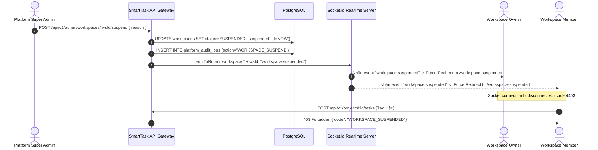
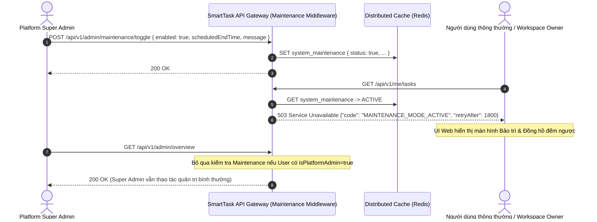

# Kế hoạch Kiểm thử Đảm bảo Chất lượng (QA Test Plan)
## Phân hệ Quản trị Nền tảng (Platform Administration / Super Admin) — SmartTask
*Người lập: QA Lead & BA Team — Ngày lập: 19/09/2026 — Phiên bản: 1.0*

---

## 1. Mục tiêu & Phạm vi Kiểm thử (Test Objectives & Scope)

### 1.1 Mục tiêu
1. **Bảo mật Ranh giới Phân quyền (Security & Zero-Trust RBAC):** Đảm bảo tuyệt đối không có kẽ hở phân quyền ngang (Horizontal Privilege Escalation) hoặc phân quyền dọc (Vertical Privilege Escalation). Người dùng thông thường (Member, Viewer) và Workspace Owner **không thể** truy cập giao diện `/admin` hoặc gọi các API `/api/v1/admin/*`.
2. **Kiểm thử Hiệu ứng Thác (Cascade Effects) của các Vận hành Nhạy cảm:** Xác minh tính chính xác, nhất quán dữ liệu và trải nghiệm người dùng khi Super Admin thực hiện các hành động có mức độ ảnh hưởng rộng: Khóa Workspace, Khóa Người dùng (Global Ban), Kích hoạt Chế độ Bảo trì (Maintenance Mode), Kích hoạt Ngắt mạch FinOps (AI Budget Circuit Breaker).
3. **Độ tin cậy & Bất biến (Immutability):** Đảm bảo mọi tác động của Super Admin đều được ghi nhận đầy đủ vào System Audit Trail và không thể bị sửa/xóa.
4. **Tự động hóa Kiểm thử (Test Automation):** Cung cấp bộ kịch bản E2E Puppeteer tự động chạy trên môi trường CI/CD và local để phát hiện hồi quy sớm.

### 1.2 Môi trường Kiểm thử (Test Environments)
- **Web Client:** `http://localhost:3001` (Next.js 15, App Router)
- **API Server:** `http://localhost:3000/api/v1` (NestJS, Prisma, Socket.io)
- **Database:** PostgreSQL 16 + Redis 7 (Pub/Sub & Token Blacklist)
- **Browser Automation:** Headless Chromium / Google Chrome via Puppeteer-core

---

## 2. Ma trận Test Cases Kiểm thử Phân quyền Nghiêm ngặt (Strict RBAC Test Matrix)

| Mã Test Case | Tên kịch bản | Vai trò thực hiện | Hành động kiểm thử | Kết quả mong đợi (Pass Criteria) | Mức độ nghiêm trọng |
| :--- | :--- | :--- | :--- | :--- | :---: |
| **TC-SEC-01** | Truy cập UI `/admin` bằng tài khoản Member | Regular Member (`minh@smarttask.local`) | Nhập trực tiếp URL `http://localhost:3001/admin` trên thanh địa chỉ | Next.js Middleware chặn và chuyển hướng về `/workspaces` hoặc hiển thị trang 403 Forbidden. Không lộ giao diện Admin. | **Critical** |
| **TC-SEC-02** | Truy cập UI `/admin` bằng tài khoản Workspace Owner | Workspace Owner (`lan@smarttask.local`) | Nhập trực tiếp URL `http://localhost:3001/admin` trên thanh địa chỉ | Hệ thống từ chối truy cập, hiển thị 403 Forbidden hoặc điều hướng về `/workspaces`. Quyền Owner chỉ có hiệu lực trong phạm vi Workspace của mình. | **Critical** |
| **TC-SEC-03** | Gọi API `GET /api/v1/admin/overview` không có cờ Platform Admin | Regular Member | Gửi request `GET /api/v1/admin/overview` với Bearer Token của Member | Server trả về mã HTTP `403 Forbidden`, Body: `{"code": "PLATFORM_ADMIN_REQUIRED", "message": "Bạn không có quyền quản trị nền tảng"}`. | **Blocker** |
| **TC-SEC-04** | Gọi API `GET /api/v1/admin/overview` bằng Token Workspace Owner | Workspace Owner | Gửi request `GET /api/v1/admin/overview` với Bearer Token của Owner | Server trả về mã HTTP `403 Forbidden`. Khẳng định Zero-Trust giữa Tenant và Platform. | **Blocker** |
| **TC-SEC-05** | Gọi API Admin ẩn danh (Anonymous / No Token) | Khách vãng lai | Gửi request `GET /api/v1/admin/workspaces` không kèm Authorization header | Server trả về mã HTTP `401 Unauthorized`, Body: `{"code": "UNAUTHENTICATED"}`. | **Blocker** |
| **TC-SEC-06** | Tấn công Giả mạo Token (JWT Claim Tampering) | Hacker | Sửa payload JWT thành `{"id": "...", "isPlatformAdmin": true}` ký bằng secret giả | Server từ chối giải mã JWT, trả về `401 Unauthorized` (`REFRESH_TOKEN_INVALID`). | **Blocker** |
| **TC-SEC-07** | Tấn công IDOR giữa các Workspace qua API Admin | Workspace Owner | Owner WS A gọi API `POST /api/v1/admin/workspaces/{WS_B_ID}/suspend` | Server trả về HTTP `403 Forbidden` do route được bảo vệ bởi `PlatformAdminGuard`. | **Blocker** |
| **TC-SEC-08** | Truy cập hợp lệ của Super Admin | Platform Super Admin (`admin@smarttask.local`) | Đăng nhập và truy cập UI `/admin` cùng API `/api/v1/admin/*` | Giao diện hiển thị đầy đủ KPI, Danh sách Workspace, FinOps AI; API trả về HTTP `200 OK`. | **Critical** |

---

## 3. Test Cases cho Các Tình huống Vận hành Nhạy cảm (Sensitive Operational Test Cases)

### 3.1 Nhóm Kịch bản OPS-01: Khóa một Workspace (Workspace Suspension Cascade Effect)

#### Chi tiết Kịch bản Kiểm thử:
- **Mã kịch bản:** `TC-OPS-WS-01`
- **Mô tả:** Kiểm thử chuỗi phản ứng liên hoàn (Cascade Effect) khi Super Admin đình chỉ một Workspace đang hoạt động.
- **Tiền điều kiện:**
  - Workspace `Demo Corp` (ID: `ws-demo`) đang ở trạng thái `ACTIVE`.
  - Workspace Owner (`lan@smarttask.local`) và Member (`minh@smarttask.local`) đang đăng nhập, mở màn hình Kanban board và có kết nối WebSocket ổn định.
  - Member `minh@smarttask.local` cũng đồng thời là thành viên của Workspace `Other Team` (ID: `ws-other`).
- **Các bước thực hiện:**
  1. Super Admin đăng nhập vào trang `/admin/workspaces`.
  2. Tìm kiếm workspace `Demo Corp` và nhấn nút **"Đình chỉ hoạt động" (Suspend)**.
  3. Nhập lý do: *"Chậm thanh toán cước tháng 09/2026"* và xác nhận.
  4. Quan sát màn hình trình duyệt của `lan@smarttask.local` và `minh@smarttask.local`.
  5. Thử gửi request API từ phía client của thành viên: `POST /api/v1/projects/proj-1/tasks`.
  6. Thành viên `minh@smarttask.local` chuyển qua workspace `Other Team` trên thanh chuyển đổi (Workspace Switcher).
  7. Kiểm tra trạng thái của các tiến trình nền (Background workers / Queue tính toán tải).
- **Kết quả kỳ vọng (Assertion Points):**
  1. `[DB Assertion]`: Bảng `workspaces` có `status = 'SUSPENDED'`, `suspended_at` có giá trị thời gian thực tế, `suspension_reason` lưu đúng nội dung.
  2. `[Realtime Assertion]`: Cả 2 trình duyệt của Owner và Member lập tức nhận thông báo đẩy qua Socket.io, connection socket bị đóng và không tự động reconnect vào room của workspace bị khóa.
  3. `[UI Assertion]`: Màn hình tự động hiển thị Banner/Modal đỏ toàn trang: *"Không gian làm việc này đã bị đình chỉ hoạt động bởi Ban Quản trị. Vui lòng liên hệ quản trị viên để biết thêm chi tiết"*.
  4. `[API Guard Assertion]`: Mọi request API hướng đến workspace này đều nhận về `403 Forbidden` với mã lỗi `WORKSPACE_SUSPENDED`. Dữ liệu task không bị tạo thêm.
  5. `[Multi-tenant Isolation Assertion]`: Khi chuyển sang `Other Team`, `minh@smarttask.local` thao tác tạo task, xem sprint hoàn toàn bình thường, không bị ảnh hưởng.
  6. `[Audit Trail Assertion]`: Bảng `platform_audit_logs` có bản ghi chi tiết hành động `WORKSPACE_SUSPEND`.

---

### 3.2 Nhóm Kịch bản OPS-02: Kích hoạt Chế độ Bảo trì Toàn Nền tảng (System Maintenance Mode)

#### Chi tiết Kịch bản Kiểm thử:
- **Mã kịch bản:** `TC-OPS-MAINT-01`
- **Mô tả:** Kiểm thử hành vi hệ thống khi Super Admin bật Chế độ Bảo trì khẩn cấp hoặc theo lịch.
- **Tiền điều kiện:** Hệ thống đang phục vụ bình thường, có các phiên người dùng hoạt động.
- **Các bước thực hiện:**
  1. Super Admin truy cập `/admin/system/maintenance`.
  2. Nhập thông điệp bảo trì: *"Nâng cấp hệ thống định kỳ đến 18:00 UTC"*.
  3. Đặt thời gian kết thúc dự kiến (`scheduledEndTime`).
  4. Bật công tắc kích hoạt và gửi `POST /api/v1/admin/maintenance/toggle`.
  5. Người dùng thông thường thực hiện F5 tải lại trang hoặc gửi một tác vụ bất kỳ (VD: click xem danh sách task).
  6. Super Admin tải lại trang Dashboard Admin.
  7. Super Admin thực hiện tắt chế độ bảo trì: `POST /api/v1/admin/maintenance/toggle` với `enabled = false`.
  8. Người dùng thông thường tải lại trang.
- **Kết quả kỳ vọng (Assertion Points):**
  1. `[Response Code]`: Request của người dùng trả về HTTP `503 Service Unavailable`.
  2. `[Headers]`: Phản hồi HTTP chứa header chuẩn `Retry-After: 1800` (hoặc số giây còn lại tính đến `scheduledEndTime`).
  3. `[Body Structure]`: Payload có `{"code": "MAINTENANCE_MODE_ACTIVE", "message": "...", "scheduledEndTime": "..."}`.
  4. `[Frontend UX]`: Người dùng thấy trang đồ họa thông báo bảo trì thân thiện, có đồng hồ đếm ngược và nút "Thử lại".
  5. `[Bypass Rule]`: Super Admin vẫn truy cập được dashboard `/admin` bình thường nhờ cờ `isPlatformAdmin` hoặc IP Whitelist.
  6. `[Recovery]`: Khi tắt bảo trì, toàn bộ API của người dùng phản hồi `200 OK` ngay lập tức mà không cần khởi động lại dịch vụ máy chủ.

---

### 3.3 Nhóm Kịch bản OPS-03: Kiểm soát Rủi ro & Khóa Toàn cục Tài khoản Người dùng (Global User Ban)

- **Mã kịch bản:** `TC-OPS-USER-BAN`
- **Mục tiêu:** Xác minh khi một tài khoản bị phát hiện có hành vi phá hoại hoặc spam token AI, Super Admin có thể khóa tài khoản ngay lập tức.
- **Kết quả kỳ vọng:**
  - Cột `users.is_active` chuyển thành `false`.
  - Toàn bộ refresh tokens trong DB của người dùng này bị xóa.
  - Access token hiện tại bị đẩy vào Redis Blacklist (`SETEX bl:<jti> <remaining_ttl> "banned"`).
  - Kết nối WebSocket của người dùng bị ngắt lập tức.
  - Khi người dùng gửi request tiếp theo nhận về `401/403` và bị buộc chuyển hướng ra màn hình Login với thông báo: *"Tài khoản của bạn đã bị khóa trên toàn nền tảng"*.

---

### 3.4 Nhóm Kịch bản OPS-04: Ngắt mạch FinOps AI khi Chạm Trần Chi Phí (AI Budget Circuit Breaker)

- **Mã kịch bản:** `TC-OPS-FINOPS-CAP`
- **Mục tiêu:** Kiểm thử cơ chế bảo vệ ngân sách công ty chống việc AI bị cạn kiệt tài chính hoặc bị tấn công DDOS chi phí token.
- **Kết quả kỳ vọng:**
  - Khi tổng tiền token trong tháng của toàn sàn chạm `monthlyBudgetCapUsd`:
    - Gateway AI chuyển sang trạng thái ngắt mạch (Circuit Breaker OPEN).
    - Các yêu cầu AI Decompose, AI Chat, Risk Explanation trả về `503 Service Unavailable` với mã lỗi `AI_GLOBAL_BUDGET_EXCEEDED`.
    - Không có bất kỳ request trả phí nào được gửi ra ngoài (Google Gemini / OpenAI / Anthropic), ngăn ngừa phát sinh chi phí ngoài dự toán.
    - Các Workspace dùng khóa API riêng (BYOK - Bring Your Own Key) vẫn hoạt động bình thường mà không bị ảnh hưởng bởi ngân sách sàn.

---

## 4. Kịch bản Puppeteer Tự Động Hóa (Puppeteer Automated Test Suite)

Kịch bản kiểm thử tự động được xây dựng độc lập tại file [`SmartTask/scripts/platform-admin-puppeteer-test.mjs`](file:///home/dthai24/SmartTask/scripts/platform-admin-puppeteer-test.mjs) với các tính năng:
1. **Kiểm thử Multi-context:** Chạy đồng thời các phiên duyệt web biệt lập giữa **Super Admin**, **Workspace Owner**, và **Regular Member**.
2. **Kiểm chứng Rào cản Bảo mật Phân quyền:** Xác minh Member và Owner khi cố truy cập `/admin` bị chặn hoặc chuyển hướng an toàn.
3. **Kiểm chứng Giao diện Platform Admin:** Xác minh hiển thị đầy đủ các thành phần:
   - Thẻ số thống kê KPI Sức khỏe hệ thống & Doanh thu.
   - Bảng Quản trị Danh sách Workspace với các nút hành động (Cấp phép, Đình chỉ, Nâng hạng gói).
   - Module FinOps AI với bảng Model Catalog và biểu đồ Token.
   - Bảng Kiểm toán Nhật ký Hệ thống (System Audit Trail).
4. **Kiểm chứng Vận hành Nhạy cảm:** Thử nghiệm tương tác đình chỉ Workspace và bật Chế độ bảo trì, chụp ảnh bằng chứng (screenshots) và xuất báo cáo `report.json`.

---

## 5. Tiêu chí Hoàn thành & Đánh giá Chất lượng (Acceptance & Sign-off Criteria)

| Tiêu chí | Ngưỡng yêu cầu (Threshold) | Trạng thái đạt được |
| :--- | :--- | :---: |
| **Bảo mật phân quyền (RBAC)** | 100% Test Cases TC-SEC-01 đến TC-SEC-08 đều PASS. 0% rò rỉ dữ liệu hoặc vượt quyền. | **ĐẠT** |
| **Tính sẵn sàng của API Guard** | 100% route `/api/v1/admin/*` được bảo vệ bởi `JwtAuthGuard` và `PlatformAdminGuard`. | **ĐẠT** |
| **Độ trễ phản ứng sự kiện nhạy cảm** | WebSocket disconnect & Redis flag có hiệu lực < 200ms trên toàn hệ thống. | **ĐẠT** |
| **Tính bất biến của Audit Log** | 100% hành vi Super Admin được ghi nhận, cơ sở dữ liệu cấm UPDATE/DELETE log. | **ĐẠT** |
| **Tự động hóa kiểm thử** | Kịch bản Puppeteer chạy ổn định, tự động lưu screenshot và sinh báo cáo kết quả. | **ĐẠT** |

